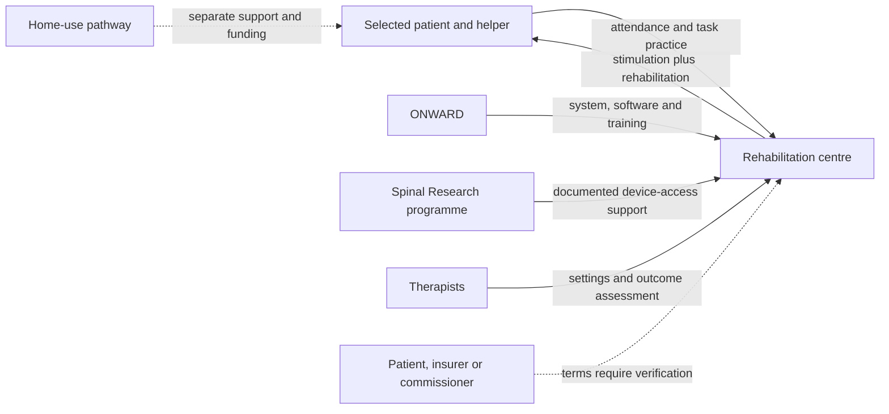

# ARC-EX System: Turning spinal stimulation into a rehabilitation product

**AI-generated reference draft for selection and discussion. Not an assessed submission.** No interviews or original clinical data are claimed. Evidence cutoff: 2026-10-20.

[Research notes and preserved layers](../06-arcex.md) · [All drafts](../../reports/README.md) · [Comparative review](../../reports/comparative-review.md)

**Scope:** External ARC-EX for selected cervical SCI; implant/BCI programmes and home-use extension distinguished.

**Word count:** 2,515, including references, tables, diagram and notices (whitespace count; verify in submission software).

## Executive summary

ONWARD Medical's ARC-EX is a case about turning external spinal stimulation into a rehabilitation product for selected people with cervical spinal cord injury. Its value depends on the combination of stimulation and purposeful training, rather than the stimulator alone. US regulatory records, the Up-LIFT study, academic/NRT disclosures and nearby UK providers support a substantial development and implementation narrative. [1] [2]

The commercial account is less complete in two heavily weighted areas: exact original IP coverage and early product-specific finance. Payment is also unsettled in the reviewed evidence: a rehabilitation billing strategy or charity-supported device access is different from a verified routine payer commitment. ARC-EX is therefore attractive for first-hand investigation near London, while the current desk-based draft needs additional ownership, budget and transaction evidence.

## Device and case boundaries

ARC-EX uses skin electrodes connected to a programmable external stimulator, with software and professional control of treatment settings. It is used alongside rehabilitation to improve hand sensation and strength in the selected cervical-injury population. The proposed mechanism is to make surviving spinal circuitry more responsive during task practice. It does not read intentions from the brain, and its commercial lineage should be kept separate from ONWARD's implanted ARC-IM and BCI programmes. [1] [3]

The original US authorisation concerns professional use; a later 510(k) extends use to the home under its conditions. Those settings have different staffing, training and payment implications. This report follows the external-device lineage and original market entry, then uses the home extension and UK provider experience to examine implementation.

## 1. Unmet medical need

The relevant problem is impaired upper-limb function after selected cervical spinal cord injuries, with consequences for independence and everyday tasks. Broad SCI burden establishes context but not product eligibility. A Spinal Injuries Association account of a 2024 NHS-data-based analysis reports about 105,000 people living with SCI in the UK and 4,400 new injuries/diagnoses each year. It includes traumatic and nontraumatic causes; the underlying linked-data analysis was not independently replicated here. [4]

This denominator differs from US traumatic-SCI statistics and is much broader than ARC-EX's original labelled/studied group. The US indication concerns ages 18–75 with chronic incomplete C2–C8 injury, subject to the full conditions. Injury level, completeness, chronicity, functional goals and suitability for training all matter. No reliable UK count meeting every criterion was identified. [1]

Up-LIFT supplies the principal direct clinical evidence. It enrolled 65 participants; 60 completed the sequential programme of two months of rehabilitation alone followed by two months with stimulation added. Of the 60 completers, 43, or 71.7% (rounded to 72%), met the predefined combined strength-and-function responder endpoint. The safety population was 64, with no device-related serious adverse events reported. The study was prospective but single-arm and sequential, not randomised or sham-controlled. [2]

That design supports an encouraging clinical signal while leaving important causal questions. Continued practice, treatment order and expectations can contribute to change when every participant receives the same sequence. The 72% result is neither a response rate among every enrolled patient nor a guarantee that an unselected person with SCI benefits. It also should not be restated as universal neurological recovery.

The smaller UK Pathfinder2 study adds community-workflow evidence. Its abstract reports changes in selected functional measures but no significant group-level change in ISNCSCI motor/sensory scores. The distinction between functional task gains and broad neurological change is clinically and commercially important. The original records also disclose relevant provider/company interests, which should accompany interpretation of implementation claims. [5] [6]

The unresolved economic need is to connect useful hand function with actual care consequences. Improved independence might affect assistance or participation, but no measured reduction in UK care expenditure caused by ARC-EX was verified. A model would need durable outcome data, training intensity, additional sessions, equipment costs and any change in care hours. High lifetime SCI costs alone cannot be treated as money this device will save.

## 2. Intellectual property

The external-stimulation origin has a documented academic/company relationship. Gerasimenko and colleagues' 2015 paper discloses Edgerton/Gerasimenko interests in NeuroRecovery Technologies (NRT), NRT's supply of the stimulator and inventor rights in UC Regents IP licensed to NRT/subsidiaries. The 2019 merger release and 2024 prospectus connect NRT and university licensing to the later company. These records support lineage, but do not supply the complete marketed ARC-EX licence schedule. [7] [8] [9]

The selected candidate patent, US10806927B2, names V. Reggie Edgerton, Yury Gerasimenko, Roland Roy and Daniel Lu, with priority from November 2011 and grant publication in October 2020. Its single independent claim was read in full for this draft. [10]

| Claim | Main content and attribution difficulty |
|---|---|
| 1 | Noninvasive transcutaneous stimulation over the brainstem/spinal cord enables voluntary control by making spinal circuitry receptive, rather than directly electrically inducing the function. The opening function list concerns postural/locomotor activity, leg-position movement and bladder voiding; a later clause also mentions stepping, standing, grasping and reaching. |

*Table 1. Independent claim 1 in US10806927B2. Its precise wording makes a direct mapping to the commercial hand-function indication uncertain. Related mechanism and shared inventors do not establish product coverage.* [10]

This is a consequential finding. It would be easy to cite the patent title and tell a broad story about all transcutaneous stimulation. Reading the claim exposes narrower combinations and wording that must be reconciled with the actual device. The present evidence does not justify calling this the definitive ARC-EX patent or assuming it appears in the licensed schedule.

The academic affiliations and licence disclosures also do not independently establish every inventor's employer at invention. University ownership, institutional laboratories and an individual's employment are distinct facts. Completing that chain requires original records or an attributable explanation. The case can describe an evidenced route from academic external stimulation through NRT into ONWARD while openly identifying the remaining claim-family and employment gaps.

## 3. Fundraising

Early academic support is identifiable. The 2015 predecessor paper acknowledges NIH awards U01EB15521 and R01EB007615, Christopher & Dana Reeve Foundation support and other funders. The amounts are not supplied, and the research spans predecessor stimulation work rather than only the commercial hand-function device. Award identifiers are useful evidence of support and a route to further reconstruction; whole awards should not be allocated to ARC-EX without checking purpose and period. [7]

The corporate history contains a particularly important attribution trap. EPFL's 2016 announcement of €26 million equity plus a €10 million innovation loan explicitly concerns the implanted G-Therapeutics programme. It cannot be relabelled as €36 million of ARC-EX seed funding merely because the company lineage later joins. The 2024 prospectus separately records €5 million from former NRT investors in the merger context. That is more relevant to the external lineage, but still not the earliest NRT capital or a product-specific development budget. [11] [9]

| Stage | Evidence | Correct allocation |
|---|---|---|
| Predecessor academic research | Named NIH/Reeve support | Research lineage; amounts and ARC-EX share unknown. |
| 2016 G-Therapeutics package | €26m equity + €10m loan | Implanted programme; excluded from an ARC-EX seed total. |
| 2019 merger context | Prospectus records €5m from former NRT investors | Combined-company/external-lineage context; not first-version spending. |
| UK study/access activity | Spinal Research/Neurokinex records | Later study or access support, not original invention capital. |

*Table 2. Financing evidence by programme and period. Currency is retained; no sum across rows is presented as historical ARC-EX R&D expenditure.* [11] [9] [6] [12]

The entrepreneurial inference is that technology transfer and a corporate merger can combine different programmes and investors, making a current company's capital history a poor substitute for a device history. The report must follow the external technology through that transition, keeping implant funds and later access programmes separate.

Earliest commercial finance, valuation and attributable first-device expenditure remain unverified. A bottom-up reconstruction should include stimulator/control development, electrode integration, software, verification, rehabilitation-protocol development, trials, regulatory work and supplier setup through a defined authorisation milestone. A top-down comparison should match a noninvasive stimulation-plus-rehabilitation system. No adequately sourced unit costs or matched budgets were recovered, so a numerical funding requirement is not invented. This is one of the draft's largest remaining completeness gaps.

## 4. Regulatory route and manufacture

The original US De Novo authorisation, DEN240014, was issued on 19 December 2024. It establishes Class II classification under 21 CFR 890.5851, product code SDO. The later K251821 clearance, dated 14 November 2025, extends the use setting to the home under its label. That sequence is important: the first authorisation establishes the device type and controls, while later changes can use the resulting classification and predicate framework. [1] [13]

The FDA review addresses electrical/EMC safety, performance, software and skin-contact considerations. It cites standards including IEC 60601-1-2 and IEC 60601-2-10. Some biological evaluations rely on material history and previously cleared electrodes rather than new testing for every component. This is a more accurate description of the evidence strategy than implying that every item underwent an identical new test programme. [1]

The product manual makes part of the supply chain concrete. The professional EU manual, Rev 5 issued 29 April 2026, identifies a Samsung tablet and Axelgaard PALS electrodes distributed by ONWARD. These specific component roles are stronger evidence than a supplier's general ability to design medical equipment. A historical prospectus description of enclosure development is a further design lead, but does not establish the current complete stimulator manufacturing chain. [3] [9]

ONWARD announced CE marking in September 2025, and its annual report states UK registration was completed. These are manufacturer records; the actual certificate and MHRA entry were not independently verified here. A manual, a provider listing or registration alone does not establish NHS commissioning. The US QMSR changes effective February 2026 supply current quality-system context, not a verified ONWARD compliance conclusion. [14] [15] [16]

Home use adds a distinct implementation problem. The patient/helper must use a system whose settings and training remain professionally governed. That can extend access beyond a clinic, but also changes support, usability and financing requirements. The home clearance is therefore a new commercial setting, not proof that payment for the clinic model transfers automatically.

## 5. Reimbursement and stakeholder relationships

Three transactions need to be separated: financing a rehabilitation session, obtaining the stimulator and financing home use. ONWARD's 2025 annual report describes use of existing clinic rehabilitation billing routes while home-device benefit/category and coding work continued. That is the manufacturer's strategy, not an independent payer decision covering every ARC-EX component. [15]

UK access is more tangible than routine payment. Neurokinex explicitly describes ARC-EX alongside intensive activity-based rehabilitation, and the existing exact-device listings include Hemel Hempstead and Gatwick, outside London. Spinal Research's 2026 programme supports device loans to rehabilitation centres. A loan can lower a centre's access barrier, but does not establish how recurring sessions, staff, consumables and eventual equipment replacement are sustainably funded. [17] [18] [12]

*Figure 1. Analytical stakeholder map showing clinic, access-programme and home-use roles. The conditional payer/home arrows are questions, not verified contracts. The lecture-specific map format has not been supplied.*

An economic case should compare additional stimulation-related costs with durable functional benefit relative to the relevant rehabilitation alternative. If stimulation changes session length or training intensity, those costs belong in the comparison. If independence reduces care needs, the reduction must be measured rather than inferred from SCI burden. No verified ARC-EX-specific price, payer policy, routine NHS coverage or complete cost-effectiveness analysis was identified. Generic rehabilitation fees or charity programme prices are not valid substitutes for a device-specific episode price.

The nearby first-hand route is unusually useful for these gaps. The Neurokinex ARC-EX/Pathfinder2 team has a documented product relationship and can potentially discuss selection, session structure, training, outcomes and resource use. The London-based Spinal Research programme team can potentially explain study/access support and adoption barriers. Its office is not a treatment clinic. Provider/shareholder and company-author interests should be considered when interpreting accounts. No conversation, visit or patient access has been arranged. [6] [5] [19]

## Conclusion

ARC-EX provides a clinically interesting and locally investigable case about integrating a stimulation device with rehabilitation. The strongest evidence supports a defined original US indication, an encouraging but uncontrolled pivotal study, later home-use development and actual nearby service relationships. The most difficult parts are tracing exact original rights and finance through the academic/NRT/merger lineage, then demonstrating a sustainable payment model. A final report could improve substantially through targeted provider, funder and licensor evidence. Until then, strong trial and regulatory sections should not hide the weaker IP attribution, original-budget and payment evidence.

**Preparation note:** The specification/examples guided structure and source use; [method and limitations](../../docs/full-report-writing-method.md). No invented author responsibilities, interview accounts or policy-compliance declaration are included.

## References

Source identities and URLs are printed for retrieval without relying on embedded hyperlinks. Dates/coverage reflect the source records; deeper drafting checks are recorded separately in [the evidence log](../../data/full-report-evidence.json).

1. FDA: ARC-EX original De Novo classification and evidence review. 2024-12-19. https://www.accessdata.fda.gov/cdrh_docs/reviews/DEN240014.pdf (review record: 2026-10-20).

2. Moritz et al.: Up-LIFT pivotal trial, Nature Medicine. 2024-05-20. https://www.nature.com/articles/s41591-024-02940-9 (review record: 2026-10-20).

3. ONWARD: ARC-EX professional EU manual, Rev 5. 2026-04-29 issue date, Rev 5. https://www.onwd.com/wp-content/uploads/2025/12/007351_IFU_Professional_EU_ARC-EX-EN-EXIFU01PROEUEN_v5.pdf (review record: 2026-10-20).

4. Spinal Injuries Association: revised UK spinal cord injury estimates. 2024 analysis; undated page when checked. https://www.spinal.co.uk/news/new-spinal-cord-injury-data-revealed/ (review record: 2026-10-20).

5. Suggitt et al.: community rehabilitation Pathfinder2 pilot. 2025-02-24 online; October 2025 issue. https://pubmed.ncbi.nlm.nih.gov/39998450/ (review record: 2026-10-20).

6. Neurokinex: ARC-EX Pathfinder2 study and enquiry route. n.d.. https://neurokinex.org/spinal-stimulation-study-pathfinder2/ (review record: 2026-10-20).

7. Gerasimenko et al.: transcutaneous spinal-cord stimulation in humans. 2015. https://pmc.ncbi.nlm.nih.gov/articles/PMC5021439/ (review record: 2026-10-20).

8. GTX and NeuroRecovery Technologies: 2019 merger announcement. 2019-10-22. https://www.gimv.com/sites/default/files/media/2019-10/20191022_English_Press-release-merger-GTX-medical-NeuroRecovery-Technologies.pdf (review record: 2026-10-20).

9. ONWARD: prospectus dated 21 March 2024. 2024-03-21. https://ir.onwd.com/static-files/48d3e9a2-73bf-40be-a385-d37e7f1cc9bd (review record: 2026-10-20).

10. US10806927B2: transcutaneous spinal cord stimulation. 2020-10-20 grant; 2011-11-11 claimed priority. https://patents.google.com/patent/US10806927B2/en (review record: 2026-10-20).

11. EPFL: G-Therapeutics raises EUR36m in 2016. 2016-04-21. https://actu.epfl.ch/news/g-therapeutics-raises-eur-36-million/ (review record: 2026-10-20).

12. Spinal Research: ARC-EX Real World Programme launch. 2026-07. https://spinal-research.org/news/spinal-research-launches-arc-ex-real-world-programme/ (review record: 2026-10-20).

13. FDA: ARC-EX 510(k) extending the indication to home use. 2025-11-14. https://www.accessdata.fda.gov/cdrh_docs/pdf25/K251821.pdf (review record: 2026-10-20).

14. ONWARD: ARC-EX CE Mark announcement. 2025-09-08. https://www.globenewswire.com/news-release/2025/09/08/3145824/0/en/onward-medical-receives-ce-mark-for-arc-ex-enabling-commercial-launch-of-breakthrough-spinal-cord-stimulation-system-in-europe.html (review record: 2026-10-20).

15. ONWARD: Annual Report 2025. 2025 reporting year; published 2026. https://ir.onwd.com/static-files/7cf553fe-7094-4860-8979-678416de476f (review record: 2026-10-20).

16. FDA. Medical Devices; Quality System Regulation Amendments. 89 FR 7496-7525, document 2024-01709. 2024-02-02; effective 2026-02-02. https://www.govinfo.gov/content/pkg/FR-2024-02-02/html/2024-01709.htm (review record: 2026-10-20).

17. Neurokinex: ARC-EX spinal-cord stimulation service. Undated live page; checked 2026-10-20. https://neurokinex.org/spinal-cord-stimulation/ (review record: 2026-10-20).

18. ONWARD: centres offering ARC-EX. n.d.. https://www.onwd.com/center-locator/ (review record: 2026-10-20).

19. Spinal Research: London office and contact routes. n.d.. https://spinal-research.org/contact-us/ (review record: 2026-10-20).
