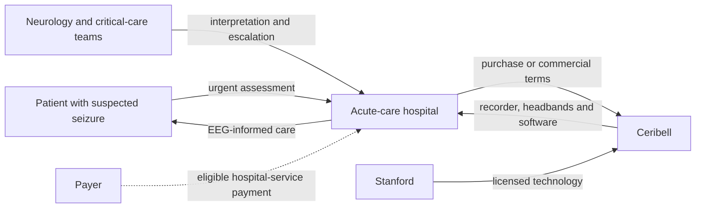

# Rapid Response EEG / Clarity: Turning EEG access into an acute-care product

**AI-generated reference draft for selection and discussion. Not an assessed submission.** No interviews or original clinical data are claimed. Evidence cutoff: 2026-10-20.

[Research notes and preserved layers](../03-ceribell.md) · [All six drafts](../../reports/README.md) · [Comparative review](../../reports/comparative-review.md)

**Scope:** Original rapid-EEG hardware/sonification and its evolution; later software and payment distinguished.

**Word count:** 2,558, including references, tables, diagram and notices (whitespace count; verify in submission software).

## Executive summary

Ceribell's early commercial proposition was rapid access to interpretable brain activity in acute care. The original product combined a quickly applied EEG headband, a portable recorder and a sound-based representation of brain signals. Later software added automated analysis. The case is strongest when those generations are traced separately: clinical workflow, university-origin sonification, early finance, hardware clearance and later software/payment developments form related but distinct events. [1] [2] [3]

Public records support an unusually detailed academic-to-company narrative, including Stanford seed support and licence terms. Evidence that rapid EEG changes access and clinical decisions is stronger than evidence of realised cash savings. A further complication is time: the US inpatient new-technology add-on for the seizure monitor ends in FY2027. Sustainable adoption therefore needs an economic case beyond a temporary supplement. [4]

## Device and case boundaries

The headband places electrodes on the scalp without an invasive procedure. The recorder displays signals and supplies an audio representation that trained clinicians can interpret. It is designed to make EEG information available during an acute decision, while conventional EEG may require a technologist and specialist interpretation. The original recorder's label did not provide an automatic diagnostic conclusion or adverse-event alert. [1]

The later Status Epilepticus Monitor belongs to a software development pathway. Evidence or authorisation for that version should not be read backwards as proof of the original system's AI performance. This report centres on the original rapid-EEG business and follows later software only where it explains commercial evolution and payment. It also keeps the separate delirium-monitor decision outside the seizure-monitor indication.

## 1. Unmet medical need

Some critically ill patients have seizure activity without obvious convulsions. Decisions made before EEG can involve the competing risks of missing ongoing activity or treating a presumed seizure unnecessarily. The 2015 ACNS consensus describes selected critical-care indications for continuous EEG and the staffing/resource constraints on its delivery. It supplies clinical-pathway context, not Ceribell-specific effectiveness or a universal seizure prevalence for all ICU patients. [5]

The unmet need is consequently an information-and-access problem within a defined care pathway. A patient can need a timely EEG decision even if no seizure is ultimately found. Estimating the addressable population from all epilepsy diagnoses would miss that feature and include many people outside the intended acute-care use. No reliable UK count of the relevant suspected-seizure episodes was established here; this remains a quantitative population gap.

DECIDE provides direct workflow evidence. It was a prospective observational study involving 181 ICU patient encounters, with complete clinical/EEG information available for 164. It reported median rapid-EEG acquisition of five minutes and conventional-EEG delay of 239 minutes, with available numbers varying by measure. The assessment concerned physician decisions and interpretations, not an autonomous AI diagnosis. It was funded by Ceribell and disclosed relevant company relationships. [6]

The study makes a plausible commercial mechanism concrete: information becomes available during a period when clinicians otherwise face uncertainty. However, it does not randomise hospitals to different care systems or demonstrate a causal reduction in mortality or length of stay. A separate 38-patient emergency-care pilot contained only one nonconvulsive status epilepticus case. Its nominal 100% sensitivity therefore had a very wide confidence interval, reported as 5%–100%, and cannot justify a broad perfect-detection claim. [7]

For a hospital, the relevant comparison is a pathway: rapid access plus appropriate escalation to further monitoring versus the existing diagnostic process. A reduced-montage early assessment and longer conventional monitoring can serve different functions. The economic value depends on whether earlier information changes treatment correctly, not simply whether more recordings are made.

No prospective before/after cost study was verified in this research. A Ceribell-specific model supplies useful economic reasoning, discussed below, but its predicted expenditure changes should not be presented as measured savings. The clinical evidence supports an access and decision-making case more firmly than a completed outcomes-and-cost case.

## 2. Intellectual property

The original sonification feature has a clear Stanford connection. US10136862B2, *Method of sonifying brain electrical activity*, names Christopher Chafe and Josef Parvizi, with priority from May 2012 and grant publication in November 2018. The university's origin account connects their work to Ceribell. This is more specific than a general claim that the company owns “EEG AI.” [8] [9]

All four independent claims in the selected granted publication were read.

| Claim | Main content |
|---|---|
| 1 | A method that filters a brain signal and continuously controls several sound parameters, including vowel, intensity and pitch, driving audible synthesis for diagnosis/treatment. |
| 18 | A processor system with signal acquisition, conversion/filtering, modulators, synthesis and a speaker implementing the sonification arrangement. |
| 20 | A system expressed through processor, memory and program instructions performing the signal-to-sound operations and playback. |
| 26 | A method using vocal synthesis in which the audible representation varies across stages of a brain-activity event. |

*Table 1. Independent claims in US10136862B2. These protect specified sonification arrangements, not every headband design or later seizure-classification algorithm.* [8]

The related licence record is unusually informative. An amendment effective April 2017 identifies the June 2015 Stanford agreement and technology dockets S11-220, S13-470 and 14-459 from the Parvizi/Chafe labs. It discloses a $36,000 first-commercial-sale milestone, while royalty percentages are redacted. A June 2025 filing reports a $250,000 payment to extend exclusivity through expiry of the last licensed patent. [10] [11]

Those records establish a contractual technology-transfer relationship and a dated commercial obligation. They do not prove that the selected patent covers every marketed feature, nor disclose the complete economics of the licence. The docket-to-family and product-to-claim map still needs completion, particularly for later Clarity software. Likewise, academic laboratory affiliation supports origin but is not a complete employment-record audit.

The entrepreneurial lesson is that usable IP can reach a company through a licence rather than a simple claim of outright ownership. Commercialisation must support both development expenditure and contractual obligations. The stated milestone and exclusivity payment belong in that analysis; they are payments associated with rights, not investment capital raised by Ceribell.

## 3. Fundraising

Stanford Bio-X attributes Ceribell's creation to a Round 6, 2012 interdisciplinary seed grant for the Parvizi/Chafe project converting brain waves to sound and image. The university account identifies support for the research stage but gives no amount. The research grant should therefore appear before corporate finance without being invented as a company seed-equity valuation. [12]

The August 2024 S-1 offers a more detailed early company history. Note 10 reports $1.0 million net Series Seed proceeds across August 2015 and April 2016, $2.0 million of convertible-note cash in 2016, and $7.0 million net Series A proceeds in the second quarter of 2017. The notes converted in May 2017. Conversion does not create the same cash a second time. [13]

| Stage | Publicly supported financing | Boundary |
|---|---|---|
| Academic origin, 2012 | Bio-X seed grant; amount not disclosed | Academic project support. |
| 2015–2016 | $1.0m net Series Seed | Company proceeds, not total invention cost. |
| 2016 | $2.0m convertible-note cash | Later conversion must not be double-counted. |
| Q2 2017 | $7.0m net Series A | Net proceeds differ from gross round announcements. |
| 2018 | $35m Series B announced | Later commercial development finance. |

*Table 2. Academic support and corporate financing stages. Original US-dollar amounts are retained. The stages should not be summed into a verified device-development budget.* [12] [13] [14]

The 2018 Series B announcement names Optimas Capital Partners Fund and The Rise Fund as leads. It helps explain later scale-up, but the earlier filing entries are more useful for the first commercial product. Together with the hardware clearances, the record supports a staged academic-research, prototype, commercial-entry and expansion narrative. It does not establish how much each activity cost. [14]

Important financing details remain private or unverified: the academic grant value, early pre-/post-money valuations, founders' non-cash contributions and expenditure attributable to particular hardware/software generations. A bottom-up reconstruction would allocate development staff, headband/recorder prototypes, software, clinical validation, regulatory work and manufacturing setup to a defined first-version endpoint. A top-down comparison would require another acute-care EEG business with comparable hardware, software and trial demands. No attributable cost inputs were verified, so the report supplies a documented financing timeline rather than a fabricated original R&D total.

## 4. Regulatory route and manufacture

The original US hardware records give a more accurate starting point than a later AI clearance alone. K170363 describes the pocket EEG recorder; K171459 covers the Class II cutaneous EEG headband, cleared in August 2017, with an age-six-and-above indication in that historical label. The recorder's eight-channel visual/audio function and lack of automatic diagnostic conclusions distinguish that generation from later event-detection software. [1] [2]

K223504 concerns the later Ceribell Status Epilepticus Monitor under the Class II EEG software pathway. The classification, intended use and validation evidence belong to that configuration. A later software record cannot establish a universal claim about every earlier headband or all current products. A strong regulatory narrative is therefore a sequence of components and intended uses, rather than a single statement that “Ceribell is FDA approved.” [3]

The validation questions follow the component risks. The original recorder summary cites EEG safety/performance under IEC 60601-2-26, electrical/EMC work under IEC 60601-1 and IEC 60601-1-2, and battery testing under IEC 62133. The headband record describes patient-contact cytotoxicity, sensitisation and irritation evaluation under the then-cited ISO 10993-5/10993-10 editions. These are actual component records, not a generic standards list. They remain historical evidence rather than a complete current conformity assessment of every later software configuration. [1] [2]

Manufacturing disclosure improves the account. The 2024 filing describes third-party headband manufacture in China and recorder final assembly in Sunnyvale, California, alongside reliance on contract manufacturers. This supports a concrete outsourced/in-house split at that date. It also identifies a business dependency: a recurring consumable and a capital recorder have different supply and scale-up requirements. Current factories, supplier contracts and the complete quality system were not audited. [13]

The US QMSR amendments effective February 2026 provide the current Part 820 quality framework, incorporating ISO 13485:2016 requirements. This context should not be confused with a certificate or proof of Ceribell's compliance. UK/EU market entry, exact current software indications and a licensed London user were not verified in this review. [15]

## 5. Reimbursement and stakeholder relationships

The economic argument is that faster correct information can avoid unnecessary treatment or prolonged care. Ney, Gururangan and Parvizi modelled rapid EEG versus clinical suspicion using diagnostic information, literature and US inpatient cost inputs indexed to 2019 dollars. Their probabilistic analysis reported approximately $5,633 savings per use case and cost savings in 75% of replications. These are modeled findings, not money observed in hospital accounts. Ceribell funded the work, and the authors disclosed founder/advisory relationships. [16]

The model is useful because it exposes the causal chain that purchasing depends on: information changes decisions, decisions change resource use, and resource changes have economic consequences. Its weakest step for a local hospital is transferability. Different staffing, availability of conventional EEG, admission patterns and bed constraints can change the result. Bed capacity released is also not equivalent to an immediate cash reduction. A hospital would need its own volumes, variable costs and actual product terms.

Payment evidence introduces an additional timing issue. The FY2027 IPPS final rule discontinues the NTAP for the Ceribell Status Epilepticus Monitor. It separately approves a Ceribell Delirium Monitor System for FY2027. The latter is not a renewal of the seizure-monitor award. NTAP expiry does not mean that every underlying hospital service ceases to be paid. [4]

*Figure 1. Analytical stakeholder map for acute-care rapid EEG. The licence relationship is documented; the purchasing/payment arrows do not assert a particular current contract. Lecture-specific map formatting remains to be confirmed.*

This leaves a substantive commercial question after temporary support ends: does the hospital's own clinical and operational value justify the recorder, consumables, software and training? No verified current price, subscription agreement, hospital contract or routine NHS coverage was identified. A favourable economic model cannot answer those transaction questions by itself.

No London Ceribell user was verified. Josef Parvizi is relevant as a product inventor and economic-paper author, with a specific connection to origin and model assumptions. General EEG expertise alone would not justify naming another local academic as a substitute for device experience. No interview was conducted, so the report contains no personal-communication evidence.

## Conclusion

Ceribell supports a persuasive case about making a specialist diagnostic resource available during an urgent clinical decision. Academic seed support, sonification claims, licence terms, early company proceeds, component clearances and supply-chain disclosure create a substantial original-development account. The main uncertainty is how strongly better access translates into patient outcomes and sustainable local economics. The public evidence supports workflow improvement and a testable value proposition; realised savings, exact current purchasing terms and the post-NTAP payment model remain less complete. Maintaining the original-hardware/later-software boundary is essential to keeping the story accurate.

**Preparation note:** The specification/examples guided structure and source use; [method and limitations](../../docs/full-report-writing-method.md). No invented author responsibilities, interview accounts or policy-compliance declaration are included.

## References

Source identities and URLs are printed for retrieval without relying on embedded hyperlinks. Dates/coverage reflect the source records; deeper drafting checks are recorded separately in [the evidence log](../../data/full-report-evidence.json).

1. FDA K170363: original Ceribell pocket EEG device. 2017; summary dated 2017-02-02. https://www.accessdata.fda.gov/cdrh_docs/pdf17/K170363.pdf (review record: 2026-10-20).

2. FDA K171459: Ceribell EEG Headband. 2017-08-21 clearance. https://www.accessdata.fda.gov/cdrh_docs/pdf17/K171459.pdf (review record: 2026-10-20).

3. US FDA. Ceribell Status Epilepticus Monitor: 510(k) decision and summary K223504. 2023-05-23. https://www.accessdata.fda.gov/cdrh_docs/pdf22/K223504.pdf (review record: 2026-10-19).

4. CMS FY2027 IPPS final rule: NTAP expiry and new technology decisions. 2026-08-04; FY2027. https://www.govinfo.gov/content/pkg/FR-2026-08-04/html/2026-15833.htm (review record: 2026-10-20).

5. ACNS consensus: continuous EEG in critically ill adults and children, indications. 2015. https://www.acns.org/UserFiles/file/Consensus_Statement_on_Continuous_EEG_in.1.pdf (review record: 2026-10-20).

6. Vespa et al.: DECIDE prospective observational study. 2020. https://ceribell.com/wp-content/uploads/2023/10/Vespa-online-CCM-DECIDE-Study-2020-1-4.pdf (review record: 2026-10-19).

7. Wright et al.: rapid EEG emergency-care pilot. 2021. https://pubmed.ncbi.nlm.nih.gov/34039642/ (review record: 2026-10-19).

8. US10136862B2: sonifying brain electrical activity. 2018 grant; 2012 claimed priority. https://patents.google.com/patent/US10136862B2/en (review record: 2026-10-20).

9. Stanford: development of the brain stethoscope and Ceribell. 2018. https://neuroscience.stanford.edu/news/stanford-researchers-listen-silent-seizures-brain-stethoscope-turns-brain-waves-sound (review record: 2026-10-20).

10. Ceribell/Stanford licence amendment: disclosed technology and milestones. Effective 2017-04-01; original agreement 2015-06-15. https://www.sec.gov/Archives/edgar/data/1861107/000095017024100574/cbll-ex10_08.htm (review record: 2026-10-20).

11. Ceribell: Stanford exclusivity extension. Event 2025-06-12; filing 2025-06-20. https://www.sec.gov/Archives/edgar/data/1861107/000095017025088309/cbll-20250612.htm (review record: 2026-10-20).

12. Stanford Bio-X: academic seed grant behind Ceribell. 2019 account of Round 6 (2012). https://biox.stanford.edu/2019-seed-grants-news (review record: 2026-10-20).

13. Ceribell: August 2024 S-1 with exhibits, public issuer archive. 2024-08-26. https://ceribell.gcs-web.com/static-files/2d3fe925-344d-40d7-b32c-cfeb9261c271 (review record: 2026-10-20).

14. Ceribell announces $35m Series B. 2018-09-25. https://www.prnewswire.com/news-releases/ceribell-announces-completion-of-35-million-series-b-financing-300717976.html (review record: 2026-10-20).

15. FDA. Medical Devices; Quality System Regulation Amendments. 89 FR 7496-7525, document 2024-01709. 2024-02-02; effective 2026-02-02. https://www.govinfo.gov/content/pkg/FR-2024-02-02/html/2024-01709.htm (review record: 2026-10-20).

16. Ney, Gururangan and Parvizi: economic model of Ceribell Rapid Response EEG. 2021; DOI 10.1080/13696998.2021.1887877. https://ceribell.com/wp-content/uploads/2023/10/ROI-Paper-Ney-241-p318-327-J-Med-Econ-2021-4.pdf (review record: 2026-10-20).
