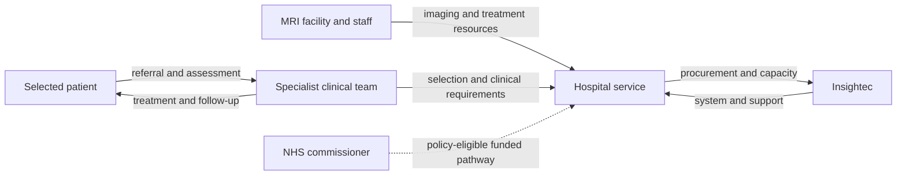

# Exablate Neuro: Making focused-ultrasound thalamotomy a clinical service

**AI-generated reference draft for selection and discussion. Not an assessed submission.** No interviews or original clinical data are claimed. Evidence cutoff: 2026-10-20.

[Research notes and preserved layers](../05-exablate.md) · [All six drafts](../../reports/README.md) · [Comparative review](../../reports/comparative-review.md)

**Scope:** Original unilateral essential-tremor market entry, with an England/London service focus.

**Word count:** 2,474, including references, tables, diagram and notices (whitespace count; verify in submission software).

## Executive summary

Insightec's Exablate Neuro shows how a technically demanding treatment can reach an established specialist service and a defined public commissioning pathway. For medication-refractory essential tremor, MRI-guided focused ultrasound creates a targeted thalamic lesion through the skull. It avoids an implanted stimulator, but requires careful selection, substantial infrastructure and acceptance of a permanent lesion. The original US evidence, an England economic model, an NHS commissioning policy and documented London equipment make the clinical-to-service account unusually tangible. [1] [2] [3]

The harder sections are original brain-device financing and exact first-version IP/manufacturing attribution. A pre-approval company financing event and a relevant aberration-correction patent improve those accounts without completing them. This report centres on unilateral essential-tremor treatment; Parkinsonian tremor has a different evidence and NHS guidance position.

## Device and case boundaries

Exablate Neuro directs energy from an ultrasound array through the skull toward a brain target. MRI supports targeting and temperature monitoring. At a sufficient thermal dose, tissue is ablated, interrupting activity in a selected circuit. Patient feedback and assessment during treatment help the clinical team evaluate effect and adverse symptoms. This is a lesion procedure, not an implanted electrical stimulator or a claim about every experimental form of ultrasound neuromodulation. [1]

The system's commercial unit includes the array/control equipment, suitable imaging infrastructure, planning, specialist staff and follow-up. The first US brain indication in 2016 gives a defined market-entry endpoint. Later bilateral and Parkinson's indications require their own decisions and economic evidence, rather than being folded into the original case.

## 1. Unmet medical need

Essential tremor can interfere with activities such as drinking, eating and writing. The relevant unmet group has disabling symptoms despite medication, rather than everyone with visible tremor. The 2022 England model refers to an estimated UK burden of approximately one million people with essential tremor; this is background drawn on by that study, not a newly verified census or a count eligible for Exablate. Clinical severity, medication response, suitability for lesion treatment and infrastructure narrow the population substantially. [4]

The original FDA evidence supplies a more precise treatment population. Its pivotal study included adults aged at least 22 with medication-refractory essential tremor, including inadequate response to appropriate trials of at least two medicines. The primary analysis involved 76 patients, allocated 56 to Exablate and 20 to sham treatment. The review reports mean improvement in its primary composite tremor/motor endpoint at three months of 46.9% with Exablate versus −0.1% with sham. That is a defined trial result, not an outcome prediction for every referred patient. [1]

The clinical value is supported by controlled evidence rather than simply the appeal of avoiding an incision. The trade-off remains important: targeted ablation can produce lasting benefit, but a lesion is permanent and neurological adverse effects matter. Suitability also depends on the treatment target, patient characteristics and the feasibility of delivering energy through the skull. These considerations affect both patient access and service throughput.

The relevant alternatives include continued medical care and other specialist procedures. A comparison with deep brain stimulation (DBS) should consider implanted hardware, adjustability, ongoing management, patient suitability and the distinct risks of lesion treatment. Avoiding an implanted generator changes the pathway; it does not eliminate MRI, planning, specialist time or follow-up. The strongest business analysis therefore compares complete pathways rather than device acquisition alone.

Geography materially changes the need. An existing specialist London service makes practical investigation possible, but does not establish that all eligible UK patients can access it promptly. The 2025 London paper explicitly identifies ExAblate equipment, while UCLH describes a relevant service. Waiting lists, referral exclusions, local capacity and current eligible volumes were not verified. These are meaningful remaining questions rather than reasons to invent a national device market from the broad disease estimate. [3] [5]

## 2. Intellectual property

A candidate enabling invention is US8088067B2, *Tissue aberration corrections in ultrasound therapy*, naming Kobi Vortman and Shuki Vitek, with priority from December 2002 and grant publication in January 2012. The assignment/name history connects it to the Insightec lineage. The technical problem is relevant: intervening tissue can change ultrasound propagation, so accurate focusing requires compensation. Exact commercial implementation, original employment and the defining first brain-device patent family remain unverified. [6]

All four independent claims in the publication were read.

| Claim | Main content |
|---|---|
| 1 | A system combining an array, imaging, tissue-boundary/sound-speed processing and element control to compensate for refraction and propagation differences. |
| 11 | A focusing method that acquires images, identifies tissue boundaries, derives element-specific corrections and delivers acoustic energy accordingly. |
| 21 | A related method that drives the corrected elements long enough to ablate the target. |
| 26 | Computer-readable software instructions performing the image, boundary and correction operations for an ultrasound system. |

*Table 1. Independent claims in the selected aberration-correction patent. System, focusing method, ablation method and software claims express related technical protection; exact Exablate Neuro coverage has not been demonstrated.* [6]

The claim set provides a substantive technical explanation, stronger than simply stating that the company has many patents. It also exposes an attribution problem: a platform invention may support several products and applications. A granted correction method should not automatically be described as the first Exablate Neuro invention or complete protection of the commercial system.

A complete IP account would connect the final system components to each necessary claim element, trace official assignments and investigate earlier/later families covering the array, MR integration and treatment control. The present source base does not establish freedom to operate or current enforceability. Nor does it document the contents of confidential calibration, production or clinical-planning know-how. Those may matter commercially, but should remain hypotheses unless records support them.

## 3. Fundraising

The most useful recovered transaction predates the 2016 US brain approval. An October 2012 investor filing announced a conditional investment agreement of approximately $31.4 million. Its terms distinguish cash from conversion of a GE loan. The December company announcement then reported completion of a $30.9 million Series C, including $27.6 million from GE and $3.3 million from other investors. These records describe agreement and completion stages; adding them would double-count a transaction history. [7] [8]

The source quality problem is visible even within a primary record. The October filing's headline gives a $106.4 million post-money valuation, while the body states $104.6 million. This report adopts neither as settled. The discrepancy needs transaction documentation or clarification, rather than an apparently reasonable silent correction. A syndicated copy of the same release would not constitute independent corroboration. [7]

The 2012 financing is evidence of company/platform capital during development, not a brain-only budget or the first funding ever received by Insightec. The later $150 million 2024 financing announcement is a growth-stage event well after the original indication. It helps distinguish continued expansion from original development, but cannot fill the missing first-version finance by substitution. [9]

| Record | What is supported | What remains open |
|---|---|---|
| October 2012 agreement | Conditional terms; mixed cash/conversion | Conflicting valuation; final terms. |
| December 2012 closing | $30.9m completed Series C announced | Brain-specific allocation and actual development spending. |
| 2024 growth round | $150m financing announced | Original early finance, not answered by a later round. |

*Table 2. Selected financing records in original US dollars. The rows are not a cumulative device-development budget.* [7] [8] [9]

The system requires investment in acoustic control, imaging integration, treatment verification, clinical work and a service ecosystem. A useful bottom-up reconstruction would allocate those activities to the first brain indication, separating shared platform investment from indication-specific work. A top-down check would use a similarly infrastructure-intensive ablation technology, adjusted for development period and study requirements. The attributable input costs and earliest transaction records were not verified. This draft therefore explains the financing sequence and its limits without presenting a guessed requirement as observed fundraising.

## 4. Regulatory route and manufacture

The original US brain indication followed the PMA route, P150038, approved on 11 July 2016. The FDA review describes a high-risk lesion-producing treatment, including preclinical/device testing, clinical evidence and manufacturing review. The clinical endpoint and patient selection belong to unilateral medication-refractory essential tremor. Later indications do not inherit identical evidence simply because the same platform is used. [1]

The relevant engineering safety case includes control of acoustic delivery and heating, image-based guidance, electrical/EMC behaviour and patient-contact materials. The review reports testing and a pre-approval manufacturing inspection. Its historical inspection conclusion is evidence about that approval process, not a complete current site list or independent audit of the present supply chain. The exact manufacturing location and outsourcing allocation were not established from the records used here. An Israeli company or R&D address alone would not prove where the finished system is manufactured. [1]

The standards story should remain linked to the actual risks and submission. Electrical/EMC and biological evaluation are documented categories; exact currently applicable editions and the complete conformity record still need verification. The current US quality framework also changed: QMSR amendments effective February 2026 incorporate ISO 13485:2016 requirements into Part 820. Older QS language should be identified as historical. [10]

UK clinical-procedure guidance must be separated from device authorisation. NICE HTG733, published in December 2024, says more evidence is needed before NHS use of focused-ultrasound thalamotomy for moderate-to-severe Parkinsonian tremor and recommends use only in formal approved research. That is different from the essential-tremor commissioning route discussed below. It is also a procedure recommendation, not an MHRA registration or CE certificate. [11]

Thus the report can describe original US market entry and an indication-specific UK adoption setting. It cannot claim a complete current global label, all later bilateral uses, or a verified present UK/EU device certificate from clinical service evidence alone.

## 5. Reimbursement and stakeholder relationships

NHS England's 2020 commissioning policy identifies a defined adult medication-refractory essential-tremor group unsuitable for DBS. This is a stronger payer starting point than a manufacturer assertion of UK availability. It should still be read as a specific policy with eligibility conditions, not a general entitlement for every tremor patient or Parkinson's indication. Current local arrangements and capacity require separate checking. [2]

An England-specific economic model makes the value argument inspectable. In a five-year NHS-perspective model, Jameel and colleagues' body tables report total per-patient costs of £19,779 for MRgFUS, £62,348 for DBS and £3,735 for no procedure. The modelled MRgFUS/no-procedure base-case ICER is £20,851 per QALY. The abstract contains an inconsistent comparator-cost statement; the body tables are used here. These are historical modelled pathway costs, not current procurement quotes or observed savings. [4]

The economic interpretation is conditional. Relative value depends on clinical benefit, the comparator, time horizon and the way fixed equipment and treatment capacity are costed. A modelled advantage over DBS does not mean MRgFUS is cheaper than continued medical care, suitable for every DBS candidate or cash-saving in each hospital.

Published correspondence makes the uncertainty especially useful for a case study. Critics questioned throughput, capital-cost and comparator assumptions. The authors replied that their NHS reimbursement-based costing accounted for capital costs and discussed the scope of the comparison, explicitly identifying ExAblate 4000. Reading both sides prevents a criticism from becoming an unqualified allegation of error. [12]

*Figure 1. Analytical map for an NHS essential-tremor service. The commissioning policy is documented; no specific equipment contract, local tariff or visit permission is asserted. Lecture-specific map formatting remains unavailable.*

The practical business question is how many appropriate patients a service can treat with its available scanner and specialist time. Fixed costs per case depend on usable capacity, while MRI time has an opportunity cost for other care. A current local costing exercise should identify equipment/service costs, treatment duration, staffing, failed eligibility screens and follow-up. It should not simply copy the model's total as the price of the machine.

The London connection is unusually relevant to these questions. The UCL/NHNN methods paper names ExAblate equipment, and the UCLH functional-neurosurgery service provides an enquiry route. That team could discuss patient selection, treatment workflow and local capacity within its experience. It is not automatically a source for original private financing or licence negotiations. No interview or observation visit has occurred. [3] [5] [13]

## Conclusion

Exablate provides the strongest UK service-and-payment story among these six drafts. Controlled original evidence, a defined commissioning policy, an England model and an exact-device London team make the pathway concrete. The case also shows why clinical novelty alone is insufficient: permanent-lesion risk, infrastructure, patient eligibility and throughput affect value. Earlier brain-specific finance, full first-version IP attribution and present manufacturing remain weaker. These gaps should be investigated directly, while keeping essential tremor separate from Parkinsonian tremor and distinguishing modelled pathway economics from actual procurement and payment.

**Preparation note:** The specification/examples guided structure and source use; [method and limitations](../../docs/full-report-writing-method.md). No invented author responsibilities, interview accounts or policy-compliance declaration are included.

## References

Source identities and URLs are printed for retrieval without relying on embedded hyperlinks. Dates/coverage reflect the source records; deeper drafting checks are recorded separately in [the evidence log](../../data/full-report-evidence.json).

1. US FDA. ExAblate System: Summary of Safety and Effectiveness Data, PMA P150038. 2016-07-11. https://www.accessdata.fda.gov/cdrh_docs/pdf15/p150038b.pdf (review record: 2026-10-19).

2. NHS England. Clinical commissioning policy: Transcranial magnetic resonance-guided focused ultrasound thalamotomy for treatment of medication-refractory essential tremor (adults). November 2020. https://www.england.nhs.uk/wp-content/uploads/2020/11/1904-transcranial-magnetic-resonance-guided-focused-ultrasound-thalamotomy-for-treatment-of-medication-refract.pdf (review record: 2026-10-19).

3. Xu, Akram et al.: FAT1-weighted MRgFUS thalamotomy. 2025; BMJ Neurology Open 7:e001104; DOI 10.1136/bmjno-2025-001104. https://neurologyopen.bmj.com/content/bmjno/7/2/e001104.full.pdf (review record: 2026-10-19).

4. Jameel et al.: England MRgFUS cost-effectiveness model. 2022. https://pmc.ncbi.nlm.nih.gov/articles/PMC9733625/ (review record: 2026-10-20).

5. UCLH: MR-guided focused ultrasound thalamotomy service. Updated 2026-06-18. https://www.uclh.nhs.uk/patients-and-visitors/patient-information-pages/thalamotomy-tremor-using-transcranial-mri-guided-focused-ultrasound (review record: 2026-10-20).

6. US8088067B2: tissue aberration correction in ultrasound therapy. 2012-01-03 grant publication; priority 2002-12-23. https://patents.google.com/patent/US8088067B2/en (review record: 2026-10-20).

7. Elbit/Insightec: conditional 2012 investment agreement. 2012-10-11. https://www.sec.gov/Archives/edgar/data/1027662/000117891312002831/exhibit_99-1.htm (review record: 2026-10-20).

8. Insightec: completed $30.9m Series C. 2012-12-09. https://www.prnewswire.com/news-releases/insightec-completes-additional-financing-round-of-309-million-182710041.html (review record: 2026-10-20).

9. Insightec announces $150m growth financing. 2024-06-18. https://www.prnewswire.com/news-releases/insightec-announces-150m-financing-to-fund-continued-growth-302176098.html (review record: 2026-10-19).

10. FDA. Medical Devices; Quality System Regulation Amendments. 89 FR 7496-7525, document 2024-01709. 2024-02-02; effective 2026-02-02. https://www.govinfo.gov/content/pkg/FR-2024-02-02/html/2024-01709.htm (review record: 2026-10-20).

11. NICE HTG733: MR-guided focused ultrasound for Parkinsonian tremor. 2024-12-18. https://www.nice.org.uk/guidance/htg733/resources/mriguided-focused-ultrasound-thalamotomy-for-treating-moderate-to-severe-tremor-in-parkinsons-pdf-1809600701173189 (review record: 2026-10-20).

12. Published critique and author reply on MRgFUS cost assumptions. 2023, BJR 96(1150). https://academic.oup.com/bjr/article/96/1150/20220995/7498967 (review record: 2026-10-20).

13. UCLH: Professor Ludvic Zrinzo. n.d.. https://www.uclh.nhs.uk/our-services/find-consultant/professor-ludvic-zrinzo (review record: 2026-10-20).
