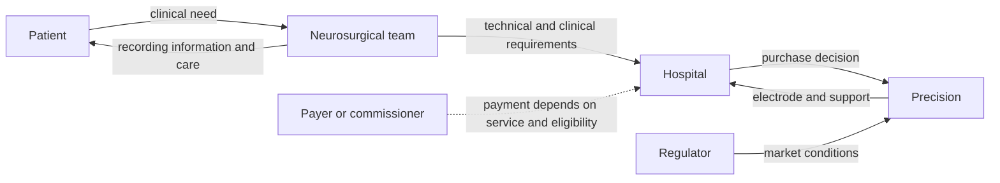

# Layer 7 Cortical Interface: From a cortical electrode to a wider BCI platform

**AI-generated reference draft for selection and discussion. Not an assessed submission.** No interviews or original clinical data are claimed. Evidence cutoff: 2026-10-20.

[Research notes and preserved layers](../01-precision.md) · [All six drafts](../../reports/README.md) · [Comparative review](../../reports/comparative-review.md)

**Scope:** Temporary Layer 7-T; original US component market, with wider BCI development treated separately.

**Word count:** 2,340, including references, tables, diagram and notices (whitespace count; verify in submission software).

## Executive summary

Precision Neuroscience illustrates a staged route from an enabling component to a much wider neurotechnology ambition. Layer 7-T is a temporary cortical electrode cleared in the United States in 2025. A permanent assistive brain–computer interface (BCI) is a different development and commercial proposition. Keeping that boundary clear makes the entrepreneurial case more convincing: early capital and manufacturing capability can support a platform, while each product still needs its own clinical purpose, evidence and payment route. [1] [2]

The strongest public evidence concerns the electrode's engineering, its clearance, an early financing sequence and a fabrication acquisition. The weakest part is the commercial value of the temporary component in a defined clinical service. No verified price, purchasing contract or product-specific payer policy was identified. Consequently, this report analyses a documented route to market and an incompletely demonstrated adoption case, rather than assuming that better neural recording automatically produces a viable clinical business.

## Device and case boundaries

Layer 7-T places a flexible electrode array against the cortical surface. Its electrodes interface with recording, monitoring and stimulation equipment. The cleared indication permits temporary use for less than 30 days, through open or burr-hole procedures. This gives the report a specific marketed product. Research involving decoding and control of another device provides development context, but does not expand that indication. [1]

The engineering attraction is a conformable surface interface with many recording sites. In principle, sampling more locations can improve spatial information while avoiding penetration by the recording contacts. The clinical question is more demanding: whether the information changes a surgical or diagnostic decision sufficiently to justify the additional equipment, integration and training. That distinction connects the five sections below.

## 1. Unmet medical need

For the temporary electrode, the unmet need should be defined around obtaining useful cortical information during an appropriate neurosurgical pathway. A general population with paralysis is a poor starting denominator because the cleared component does not itself constitute a permanent assistive BCI. Likewise, the number of people with a neurological diagnosis is not the number who need cortical-surface recording. A defensible market estimate would begin with procedures in which such recording is clinically useful, then apply eligibility, institutional capability and adoption constraints. The reviewed sources do not supply that count. [1]

The most informative original technical study is Hettick and colleagues' platform report. Its acute human pilot involved five neurosurgical patients: two under general anaesthesia and three during awake language mapping. Together with the engineering experiments, it supports feasibility of placing the interface and obtaining useful signals in a surgical setting. Precision supported the work and numerous authors disclosed company relationships. The small, acute study cannot establish lasting assistive benefit, population-wide effectiveness or lower total care costs. [3]

The relevant comparison is therefore an existing cortical-recording workflow, rather than no neurological care. Additional spatial information might support better interpretation, but contact density is an engineering attribute, not a patient outcome. An evaluation would need to measure whether the array changes clinical decisions, whether those changes improve outcomes, and whether setup or interpretation creates extra work. These are analytical requirements, not benefits already demonstrated by the five-patient pilot.

The same discipline applies to costs. No observed before/after cost study for the selected temporary component was verified. The appropriate resource comparison includes the electrode, supporting equipment, operating-room time, staff training and interpretation. A hypothetical saving in surgery time would need evidence of both time released and a financial consequence; shorter time does not automatically reduce a hospital's cash expenditure. The report can explain this value hypothesis, but cannot responsibly quantify savings from the available evidence.

## 2. Intellectual property

A technically close publication is US20230210427A1, *Systems and methods for neural interfaces*. It names Benjamin Rapoport, Demetrios Papageorgiou, Mark Hettick, Adam Poole and Elton Ho, claims priority from 31 December 2021, and records assignment to Precision. This is a published application; the reviewed metadata and text do not constitute a current prosecution or enforceability audit. The inventors' employment at the time of invention was not independently reconstructed. [4]

All four independent claims in this publication were read for this draft. Their main content is summarised below; the descriptions are shortened explanations, not legal claim construction.

| Claim | Main content and relevance |
|---|---|
| 1 | A flexible substrate with connected, separable microelectrode-array modules, nonpenetrating contacts and a pocket receiving an insertion paddle. This concerns the physical interface and delivery connection. |
| 5 | Implantation through an approximately tangential cranial opening, with dural access, paddle-guided advancement into the subdural space and withdrawal of the paddle. This concerns the insertion method. |
| 13 | Fabrication of an adhesive-backed polyimide pocket, including laser cutting, folding, alignment and pressure attachment to an array. This concerns a manufacturing method. |
| 17 | Implanting the specified interface, recording and decoding neural signals, and controlling a secondary device. This reaches a BCI use beyond temporary recording alone. |

*Table 1. Independent claims in US20230210427A1. Technical similarity identifies a candidate relationship; it does not prove that every feature is present in the marketed Layer 7-T.* [4]

The distinction between claims 1/5 and claim 17 matters commercially. The same invention family can address an interface, its insertion, its manufacture and a future application. A clearance for an electrode does not establish permission for every patented use, and a patent claim does not establish clinical effectiveness. An exact product-to-claim comparison would require the final device drawings and a check of every claim element.

The manufacturing method also suggests why protection may extend beyond a single electrode geometry. Process knowledge, reliable fabrication and integration can affect the difficulty of replication. These are plausible sources of advantage; no undisclosed trade-secret inventory is asserted here. Neither this application nor a portfolio count establishes freedom to operate. The evidence supports an explanation of candidate protection and development strategy, while leaving the complete first-version IP and employment chain incomplete.

## 3. Fundraising

Precision announced a $12 million Series A in May 2021, led by Steadview Capital and B Capital Group's Ascent Team. B Capital subsequently described Precision as a portfolio company and discussed its early development. This gives a responsible-party cross-check of the investor relationship, although the investor article does not independently establish the transaction amount. [5] [6]

The January 2023 company announcement reports a $41 million Series B led by Forepont Capital Partners and $53 million raised in total. The disclosed total is consistent with the two stated rounds. It remains a company-level account, rather than a schedule assigning capital to the temporary array, chronic interface, software or future clinical programmes. No valuation was disclosed in the reviewed records. [7]

| Milestone | Verified financing information | Interpretation |
|---|---|---|
| May 2021 | $12m Series A | Early platform/company development capital. |
| January 2023 | $41m Series B; $53m cumulative announced | Subsequent development and scale-up capital. |
| October 2023 | Manufacturing acquisition announced; purchase price not verified | A capability milestone, not another quantified funding round. |

*Table 2. Disclosed company financing and a later manufacturing milestone. Dollar amounts are the original announced US-dollar figures; no inflation adjustment or device-budget allocation is implied.* [5] [7] [8]

The financing sequence supports an entrepreneurial interpretation of staged investment: establish the technology, increase organisational and production capacity, then pursue a defined market entry. It does not establish the investors' actual decision criteria or prove that clearance was funded by a particular fraction of either round. Those would require board, investor or management evidence.

The earliest founders' contributions and a complete first-version development budget remain unknown. A bottom-up reconstruction would sum engineering staff-years, fabrication iterations, verification, sterilisation/packaging validation, regulatory work and clinical evaluation through a specified milestone. A top-down check would use comparable temporary cortical electrodes at the same stage, separating them from permanent BCI programmes. Staff effort and comparable attributable budgets were not verified, so this draft does not manufacture a numerical range. This is a substantive funding limitation despite the useful round history.

## 4. Regulatory route and manufacture

FDA K242618 cleared Layer 7-T on 30 March 2025 as a Class II cortical electrode under 21 CFR 882.1310, product code GYC. The route used substantial equivalence to an existing cortical-electrode predicate. The record supplies a concrete early-market endpoint: temporary recording, monitoring and stimulation with suitable equipment, rather than authorisation of a permanent assistive system. [1]

The summary describes nonclinical testing addressing the risks of that component, including biocompatibility, electrical/EMC performance, electrode properties, mechanical durability, packaging, sterilisation and shelf life. Examples include the ISO 10993 biological-evaluation framework and ISO 11135 ethylene-oxide sterilisation validation. This evidence demonstrates how an apparently simple array must be translated into a reproducibly manufactured clinical article. The cited standards are those in the historical submission, not a declaration that every current standard or later configuration has been audited. [1]

Manufacture is unusually visible for an early private company. In October 2023 Precision announced acquisition of a MEMS foundry outside Dallas through Precision BioMEMS. This supports a dated account of bringing fabrication capability under company control. It does not disclose the acquisition cost or establish that every component and final release step is performed there today. [8]

For the business, fabrication control could reduce dependence on external capacity and help iteration, but it also adds fixed costs, process-control obligations and yield risk. Those consequences are analysis of the operating model, not measured results of the acquisition. Market entry still depends on reproducibility and quality alongside recording performance.

Historical FDA letters refer to the former Quality System regulation. A current US account must recognise the QMSR amendments effective 2 February 2026, incorporating ISO 13485:2016 requirements into 21 CFR Part 820. This regulatory framework does not itself verify Precision's current compliance. UK/EU authorisation, current factory arrangements and complete quality documentation were not established in this review. [9]

## 5. Reimbursement and stakeholder relationships

The temporary component's buyer and financial value proposition need to be established before considering payment for future assistive BCI use. The immediate analytical model is a hospital acquiring an electrode for a clinical procedure. The clinician values reliable information; procurement evaluates compatibility, price and supply; the hospital must decide whether better care or operational value justifies its incremental expenditure. These interests need not align with an eventual home-use BCI market.

CMS explains that some integral outpatient items are packaged within payment for the main hospital service. That is a route to investigate, not evidence that Layer 7-T has a specific packaged payment or coverage determination. Setting matters: an inpatient procedure, an outpatient service and a research use can have different financing arrangements. No product-specific fee, policy, price or procurement contract was verified. [10]

*Figure 1. Analytical stakeholder map for temporary clinical use. Dashed payment is conditional; this figure does not document a Layer 7-T payer contract. The lecture-specific map format has not been supplied.*

A procurement case would compare incremental acquisition and implementation costs against measured clinical benefit and any usable resource savings. It should include compatibility with existing recording systems and the cost of interpretation, rather than treating the electrode as the whole service. A research collaboration may provide early experience, but research expenditure is not evidence of routine clinical reimbursement.

No London product user was verified. A remote discussion with an inventor or company clinical lead could clarify the original design and intended purchasing pathway, but willingness to talk and access to confidential budgets remain unknown. No interview has occurred. The absence of verified local use in this search should not be presented as evidence that no UK activity exists.

## Conclusion

Precision provides a strong example of the difficulty of defining the commercial unit in a platform company. A cleared temporary electrode, candidate array/insertion IP, disclosed early capital and a manufacturing acquisition form a coherent development story. The main unresolved step is showing how a particular clinical service pays for, uses and benefits from the component. A persuasive final case study should retain that boundary throughout; using future BCI benefits to justify current electrode economics would weaken every section. The report is useful for examining staged translation, but its eligible population, complete original IP/employment chain and actual procurement economics require further evidence.

**Preparation note:** The specification/examples guided structure and source use; [method and limitations](../../docs/full-report-writing-method.md). No invented author responsibilities, interview accounts or policy-compliance declaration are included.

## References

Source identities and URLs are printed for retrieval without relying on embedded hyperlinks. Dates/coverage reflect the source records; deeper drafting checks are recorded separately in [the evidence log](../../data/full-report-evidence.json).

1. US FDA. Layer 7-T: 510(k) decision and summary K242618. 2025-03-30. https://www.accessdata.fda.gov/cdrh_docs/pdf24/K242618.pdf (review record: 2026-10-19).

2. Precision Neuroscience product and company site. n.d.. https://www.precisionneuro.io/ (review record: 2026-10-20).

3. Hettick et al.: cortical-array technology and acute human pilot. 2025-10-02 (online; June 2026 issue). https://www.nature.com/articles/s41551-025-01501-w (review record: 2026-10-20).

4. US20230210427A1: neural interfaces and insertion system. 2023-07-06. https://patents.google.com/patent/US20230210427A1/en (review record: 2026-10-20).

5. Precision: $12m Series A announcement. 2021-05-25. https://www.prnewswire.com/news-releases/precision-neuroscience-raises-12m-to-develop-next-generation-brain-computer-interface-technology-301298952.html (review record: 2026-10-20).

6. B Capital: early Precision portfolio-company account. 2021-11-01. https://b.capital/insights/how-two-very-different-startups-adapted-to-the-covid-19-pandemic/ (review record: 2026-10-20).

7. Precision: $41m Series B announcement. 2023-01-25. https://www.globenewswire.com/news-release/2023/01/25/2595114/0/en/Precision-Neuroscience-Raises-41-Million-to-Build-and-Scale-the-Next-Generation-of-Treatments-for-Neurological-Illnesses.html (review record: 2026-10-19).

8. Precision: acquisition of a US MEMS manufacturing facility. 2023-10-05. https://www.globenewswire.com/news-release/2023/10/05/2755458/0/en/precision-neuroscience-acquires-u-s-manufacturing-facility-and-receives-fda-breakthrough-device-designation.html (review record: 2026-10-20).

9. FDA. Medical Devices; Quality System Regulation Amendments. 89 FR 7496-7525, document 2024-01709. 2024-02-02; effective 2026-02-02. https://www.govinfo.gov/content/pkg/FR-2024-02-02/html/2024-01709.htm (review record: 2026-10-20).

10. CMS: Medicare payment systems and packaged outpatient costs. FY2027 version visible when checked. https://www.cms.gov/outreach-and-education/medicare-learning-network-mln/mlnproducts/html/medicare-payment-systems.html (review record: 2026-10-20).
