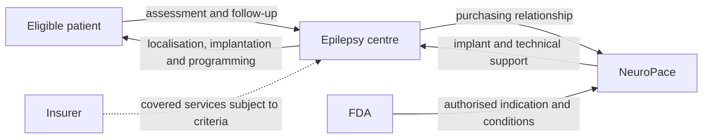

# RNS System: Building a closed-loop therapy for focal epilepsy

**AI-generated reference draft for selection and discussion. Not an assessed submission.** No interviews or original clinical data are claimed. Evidence cutoff: 2026-10-20.

[Research notes and preserved layers](../02-rns.md) · [All six drafts](../../reports/README.md) · [Comparative review](../../reports/comparative-review.md)

**Scope:** Original US RNS focal-epilepsy pathway; later model/UK questions kept separate.

**Word count:** 2,414, including references, tables, diagram and notices (whitespace count; verify in submission software).

## Executive summary

NeuroPace's RNS System is a relatively complete public case of translating responsive brain stimulation into a clinical product. It records intracranial electrical activity, detects configured patterns and delivers stimulation for selected adults with drug-resistant focal epilepsy. The business depends on more than the implant: patient localisation, surgery, programming and follow-up are integral to treatment. Original FDA evidence, long-term outcomes, a pre-approval financing filing, manufacturing disclosure, an economic model and a payer policy allow those elements to be connected. [1]

The evidence is strongest for the original US focal-epilepsy case. It is less complete for the earliest financing, employment and ownership at invention, and routine UK access. The report therefore uses the US pathway as its main commercial setting and treats London first-hand access as an unresolved practical limitation. It does not combine investigational indications with the original market.

## Device and case boundaries

RNS combines intracranial electrodes with a cranially implanted neurostimulator and external programming/data equipment. Clinicians configure detection and stimulation around the patient's seizure patterns. Sensing and intervention form a feedback loop; the clinician still selects patients, interprets recordings and adjusts therapy. This makes the product a continuing treatment service rather than a single surgical transaction. [1]

The original indication concerns adults aged at least 18 with partial/focal-onset seizures localised to no more than two foci and refractory to at least two antiseizure medicines. The original evidence covers frequent disabling seizures, averaging at least three monthly over the preceding three months, with no month below two. This report follows that scope, distinguishes the randomised evidence from later open-label follow-up, and separates historic implant models where labeling differs. [1]

## 1. Unmet medical need

The relevant problem is persistent disabling seizures despite treatment, particularly where seizure localisation and the suitability of other surgery constrain options. Counting everyone with epilepsy would substantially overstate the RNS market. In the 2021 US National Health Interview Survey, Kobau and colleagues estimated 2,865,000 adults, or 1.1%, with active epilepsy. The reported definition combines a doctor diagnosis with treatment and/or a seizure during the previous year. This establishes a dated national burden, not the device-eligible subgroup. The repository abstract was reviewed; complete uncertainty and methods require the full paper. [2]

Eligibility then narrows through drug resistance, focal onset, localisation, age and clinical suitability. The original FDA record supplies the treatment boundary. It cannot, by itself, identify how many survey respondents meet every criterion. A defensible unmet-need section should show this narrowing explicitly rather than multiply the broad prevalence by an unsupported adoption percentage. [1]

The pivotal randomised study involved 191 implanted participants. During the blinded evaluation, seizure frequency decreased by 37.9% in the active group versus 17.3% in the sham group. This supports a treatment effect beyond implantation and expectation during that period. Nine-year prospective follow-up reports a 75% median reduction, but it is an open-label result with a different design and time frame. The two percentages should not be presented as successive randomised comparisons. [3] [4]

The clinical proposition is meaningful seizure reduction rather than a guaranteed cure. Benefits must be weighed against implantation and continuing management. A payer or patient also needs to know which outcomes matter beyond frequency: adverse events, functional consequences, quality of life and the burden of repeated care. The original review and long-term evidence support that discussion; they do not eliminate individual variation or establish superiority over every other intervention.

The cost comparison is likewise a pathway comparison. Continued medicines, epilepsy-related care, implantation, programming and replacement all belong in an economic assessment. A published model considers these components, but no observed UK before/after expenditure study was verified here. Clinical improvement, health-economic value and cash savings should remain separate conclusions.

## 2. Intellectual property

US6016449A provides a foundational invention trail. Published in January 2000 from a 1997 filing, it names Robert Fischell, David Fischell and Adrian Upton. A Johns Hopkins historical account identifies Robert Fischell as NeuroPace's founder and describes his earlier Applied Physics Laboratory career. This biographical evidence does not establish his employer when the patent was filed or demonstrate a Johns Hopkins licence. [5] [6]

The granted publication contains two independent claims, both read for this draft.

| Claim | Main content and connection |
|---|---|
| 1 | Intracranial electrodes connected to a module implanted beneath the scalp; brain-derived inputs govern stimulation outputs, and external equipment communicates in both directions to retrieve data and define outputs intended to terminate a neurological event. This explains the basic responsive-stimulation architecture. |
| 46 | A similar electrode/module/external-communication architecture, with an additional remotely implanted sensor/actuator and its circuitry. That additional requirement should not be assumed present in the commercial RNS configuration. |

*Table 1. Independent claims in the selected foundational patent. The claim elements are summarised; this is not an infringement or freedom-to-operate opinion.* [5]

The first claim is useful because it connects the product's sensing, processing, stimulation and external programming functions. The second shows why an IP report must read every independent claim rather than describe the entire patent as one broad idea. Different independent claims protect different combinations, and a commercial product may relate more closely to some than others.

The Google record indicates lifetime expiry, so this historical patent should not be presented as an enduring present-day barrier. The 2021 prospectus also describes trade secrets, confidentiality and invention-assignment agreements. Those disclosures support a broader protection strategy, while leaving the technical contents of undisclosed know-how unknown. Later patents and exact current-product coverage require separate analysis. [5] [7]

The public material therefore supports a credible invention narrative and explanation of the selected independent claims. It does not complete the original employer/assignment chain or a current portfolio map. A founder's earlier university association is insufficient to fill those gaps.

## 3. Fundraising

NeuroPace's pre-approval funding is partly recoverable from securities records. A Form D signed on 30 August 2011 reports a first sale on 16 August, $49,126,004 sold and a total offering of $61,914,481. The security categories include equity and options/related securities. The amount sold and the total offered must be separated; neither can automatically be described as a completed all-cash round. [8]

The timing is commercially informative. The patent trail reaches back to the late 1990s, the company reports incorporation in November 1997, and original FDA approval arrived in November 2013. The 2011 filing captures a development-period financing event within a much longer translation effort. It is not the first-ever funding record and does not establish what each investor paid or how capital was allocated. [5] [7] [8] [1]

The extended route helps explain why financing and clinical/regulatory milestones must be analysed together. An implanted feedback system needs engineering verification, manufacturing controls, surgery and sustained clinical evaluation. Capital may have to support several of these activities before product sales can repay them. This is an interpretation of the documented development demands, not an assertion that the 2011 proceeds financed a particular trial invoice.

The 2021 IPO prospectus is a later disclosure route into company operations and financial history. Its existence makes detailed investigation easier, but later public-market finance should not replace the missing earliest-round story. The prospectus's revenues, operating expenses and financing entries also concern the company and relevant periods, rather than a retrospective price tag for inventing RNS. [7]

No defensible pre-/post-money valuation or complete first-stage capital requirement was established. A bottom-up estimate would need staff-years, prototype iterations, implant verification, trial-site and follow-up costs, regulatory expenditure and manufacturing setup through an agreed endpoint. A top-down comparison should use another implantable closed-loop therapy at a comparable stage, rather than a noninvasive EEG device. Without verified unit costs or matched comparables, a numerical estimate would add apparent precision rather than evidence. The financing section is informative but not a complete funding reconstruction.

## 4. Regulatory route and manufacture

RNS obtained original US PMA approval on 14 November 2013 under P100026. The implanted system followed the Class III/PMA route, supported by device testing and clinical evidence. Its original focal-epilepsy indication and eligibility restrictions are central to the business: market size and payer eligibility depend on them. The randomised pivotal evidence supplies more than a company assertion of benefit. [1]

The original FDA review covers biological evaluation, implanted-system and external-equipment testing, sterilisation and clinical safety/effectiveness. Examples include ISO 10993 biological testing and ethylene-oxide validation under the then-cited ISO 11135-1 framework. The relevant engineering problem is sustained safe operation in a patient, including materials, hermeticity, electrical function and reliable communication. These historical test records do not establish that every later model or indication has identical evidence. [1]

Model-specific changes matter. The February 2020 Rev 6 MRI manual distinguishes MR Conditional RNS-320 from MR Unsafe RNS-300M, with the former subject to specified conditions. A blanket statement that “RNS cannot undergo MRI” would therefore misrepresent the later model. Conversely, “MR Conditional” is not permission for any scan in any circumstances. This report uses the distinction to illustrate label evolution, not to give scanning instructions. [9]

Manufacturing is described in the April 2021 prospectus: assembly, testing, inspection and final release took place at Mountain View, California, with materials, subassemblies and services supplied externally, often from single sources. That account supports a mixed in-house/supplier operating model. It also exposes a commercial risk: qualifying a replacement supplier may take time, so component availability can constrain delivery even where final assembly is internal. It is a dated disclosure, not a current factory audit. [7]

For present US context, the QMSR amendments became effective on 2 February 2026 and incorporate ISO 13485:2016 requirements into Part 820. This should be distinguished from the former QS terminology in older records. A complete current UK/EU authorisation and manufacturing assessment was not undertaken. No London RNS user or routine NHS payment route was verified. [10]

## 5. Reimbursement and stakeholder relationships

RNS has both a public economic argument and an identifiable payer policy, which answer different questions. Youngerman and colleagues modelled RNS plus continued medicines versus medicines alone over nine years from a public-payer perspective. Across three utility estimates, the reported incremental cost-effectiveness ratio was $28,825–$46,596 per quality-adjusted life-year (QALY). The model includes implantation, programming, replacement, adverse events and care costs. The publisher abstract was reviewed; this is a model result, not a hospital purchase price or observed budget saving. [11]

Aetna CPB 0394, reviewed in June 2026, identifies responsive cortical stimulation as medically necessary for selected adults under specified criteria. These include localising no more than two epileptogenic regions, adequate trials of at least two antiseizure medicines and further clinical/surgical requirements. The entire policy and individual plan terms matter. This establishes one US payer's position rather than universal insurer or NHS coverage. [12]

The model helps explain value over time, while the policy shows how a payer translates evidence into eligibility. A successful implant is still followed by programming and long-term management. The provider must organise those services, and the payer must decide how the episode and continuing care are funded. A favourable ICER cannot establish the actual payment amount or the provider's margin.

*Figure 1. Analytical stakeholder map for the US focal-epilepsy pathway. The payer arrow is conditional; the Aetna policy establishes selected coverage criteria, not every contract or fee. The lecture-specific map format remains unavailable.*

The central adoption issue is the alignment of a substantial intervention now with benefits accumulated over years. The economic result depends on durable seizure improvement, utility mapping and the costs of continuing treatment. It is therefore important to examine sensitivity rather than repeat a single ICER as a universal conclusion. A UK adaptation would need NHS costs, relevant commissioning and local eligible patients; a currency conversion of the US model would be inadequate.

For first-hand investigation, a product-specific US clinical or development lead can address actual selection and follow-up. A London epilepsy expert could be useful only through a specific relevant clinical/purchasing question; general expertise does not establish RNS experience. No conversation or visit has occurred.

## Conclusion

RNS offers the most connected public development-to-treatment account in this set: a defined clinical group, original randomised evidence, longer follow-up, a foundational claim set, pre-approval financing, manufacturing disclosure, a value model and payer criteria. Its entrepreneurial lesson is that a closed-loop implant reaches patients through an equally important clinical and financial service loop. The remaining weaknesses concern the very earliest finance and invention arrangements, current full portfolio/label coverage and UK access. These limits reduce completeness, but do not prevent a substantive case study grounded in a coherent original US market.

**Preparation note:** The specification/examples guided structure and source use; [method and limitations](../../docs/full-report-writing-method.md). No invented author responsibilities, interview accounts or policy-compliance declaration are included.

## References

Source identities and URLs are printed for retrieval without relying on embedded hyperlinks. Dates/coverage reflect the source records; deeper drafting checks are recorded separately in [the evidence log](../../data/full-report-evidence.json).

1. US FDA. RNS System: Summary of Safety and Effectiveness Data, PMA P100026. 2013-11-14. https://www.accessdata.fda.gov/cdrh_docs/pdf10/P100026B.pdf (review record: 2026-10-19).

2. Kobau et al.: active epilepsy in US adults, 2021 NHIS. 2023. https://stacks.cdc.gov/view/cdc/154714 (review record: 2026-10-20).

3. Morrell et al.: responsive cortical stimulation trial. 2011. https://pubmed.ncbi.nlm.nih.gov/21917777/ (review record: 2026-10-19).

4. Nair et al.: nine-year prospective RNS follow-up. 2020. https://pubmed.ncbi.nlm.nih.gov/32690786/ (review record: 2026-10-19).

5. US6016449A: implantable seizure warning/treatment system. Priority 1997-10-27. https://patents.google.com/patent/US6016449A/en (review record: 2026-10-19).

6. Johns Hopkins Engineering: Robert Fischell and NeuroPace history. Fall 2008. https://engineering.jhu.edu/magazine-archive/2008/09/fischell-awarded-honorary-degree/ (review record: 2026-10-20).

7. NeuroPace: 2021 IPO prospectus amendment. 2021. https://www.sec.gov/Archives/edgar/data/1528287/000162828021006852/neuropaces-1a1.htm (review record: 2026-10-19).

8. NeuroPace: August 2011 Form D. 2011-08-30 signature. https://www.sec.gov/Archives/edgar/data/1528287/000152828711000001/xslFormDX01/primary_doc.xml (review record: 2026-10-20).

9. NeuroPace: model-specific MRI guidelines, Rev 6. 2020-02; DN 1017451 Rev 6. https://www.neuropace.com/wp-content/uploads/2021/02/neuropace-rns-system-mri-guidelines.pdf (review record: 2026-10-20).

10. FDA. Medical Devices; Quality System Regulation Amendments. 89 FR 7496-7525, document 2024-01709. 2024-02-02; effective 2026-02-02. https://www.govinfo.gov/content/pkg/FR-2024-02-02/html/2024-01709.htm (review record: 2026-10-20).

11. Youngerman et al. Cost-effectiveness analysis of responsive neurostimulation for drug-resistant focal onset epilepsy. Epilepsia 62:2804-2813. DOI 10.1111/epi.17049. 2021-08-29 online. https://onlinelibrary.wiley.com/doi/10.1111/epi.17049 (review record: 2026-10-20).

12. Aetna CPB 0394: epilepsy surgery and responsive cortical stimulation. Last review 2026-06-23. https://www.aetna.com/cpb/medical/data/300_399/0394.html (review record: 2026-10-20).
