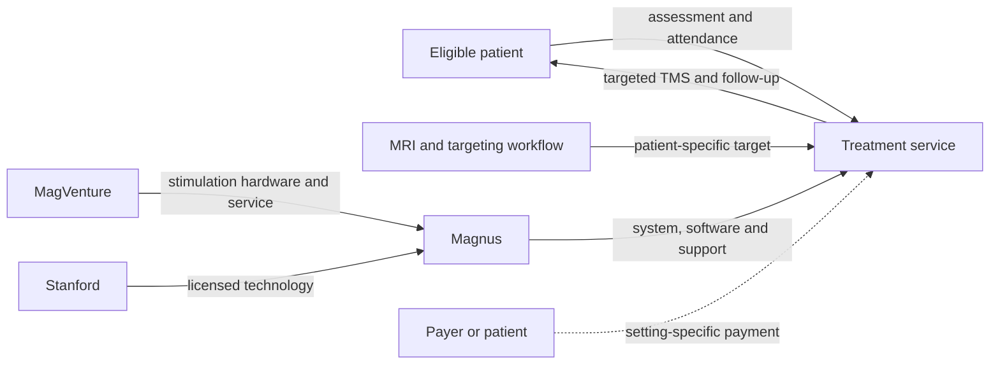

# SAINT: Commercialising a personalised five-day TMS pathway

**AI-generated reference draft for selection and discussion. Not an assessed submission.** No interviews or original clinical data are claimed. Evidence cutoff: 2026-10-20.

[Research notes and preserved layers](../04-saint.md) · [All drafts](../../reports/README.md) · [Comparative review](../../reports/comparative-review.md)

**Scope:** Academic-to-commercial SAINT and original US clearance; UK comparator context kept separate.

**Word count:** 2,425, including references, tables, diagram and notices (whitespace count; verify in submission software).

## Executive summary

Magnus Medical's SAINT case concerns commercialising an integrated treatment pathway: personalised MRI-based targeting, navigated magnetic stimulation and a compressed five-day schedule. Its proposition is faster delivery of a potentially effective intervention for adults whose depression has not improved satisfactorily with medication. The entrepreneurial challenge is to turn a small, promising academic evidence base into a reproducible, staffed and sustainably funded service. [1]

The public record connects Stanford-origin IP and research support to a $25 million company launch round, FDA clearance and a named hardware supplier. It is less complete for long-term service economics and current payer arrangements. The expiry of the temporary US inpatient NTAP for FY2027 makes those economics especially relevant. A short treatment calendar should not be mistaken for a low-resource treatment, nor should UK evidence for another TMS protocol be described as SAINT evidence. [2]

## Device and case boundaries

The Magnus Neuromodulation System with SAINT technology combines stimulation hardware, neuronavigation and software informed by structural and functional MRI. It identifies a personalised target in the left dorsolateral prefrontal cortex and delivers intermittent theta-burst stimulation. The cleared protocol compresses a course into five days, using multiple sessions per day. [1]

The original US clearance concerns adult major depressive disorder with inadequate improvement from antidepressant medication in the current episode. This report studies the academic-to-commercial transition through that 2022 clearance and subsequent service development. It does not equate every accelerated TMS protocol, MRI-guided TMS clinic or MagVenture installation with the licensed SAINT configuration.

## 1. Unmet medical need

Depression creates substantial global burden, but the relevant unmet need is narrower than the total disease population. WHO's September 2026 fact sheet reports approximately 322 million people with depression in 2023 and an adult prevalence of 5.2%. These figures are global context. They do not count people eligible for SAINT, quantify treatment resistance in London or establish capacity to receive an MRI-plus-stimulation pathway. [3]

The clinical development addresses people with persistent symptoms despite previous care. A commercially useful need statement must connect inadequate treatment response with the time, access and tolerability demands of available alternatives. The specific attraction of acceleration is that repeated treatment visits are concentrated into a shorter calendar period. Whether that improves access depends on the patient and service: fewer weeks of travel can coexist with long daily attendance and demanding staff schedules.

The original FDA summary includes a double-blind sham-controlled study of 29 participants, 14 active and 15 sham. It reports remission in 11/14 active participants versus 2/15 sham participants during the month after treatment and notes early termination at the planned interim analysis. The small sample and short observation period limit generalisation. The summary's study tables also contain an inconsistent active/sham header in one place, so this draft uses the consistent 14-active/15-sham description in the study narrative and table rows. [1]

These findings support a serious clinical-development argument, but they do not establish durable remission for all treated patients or superiority over unrelated interventions through cross-trial percentages. Larger implementation populations, follow-up, retreatment and patient selection affect both clinical and commercial conclusions. The early trial's apparent effect should therefore remain attached to its actual design and denominator.

A UK comparison helps make the care-pathway problem concrete. The NIHR BRIGhTMIND trial randomised 255 people with treatment-resistant depression between connectivity-guided iTBS and rTMS, delivered over 20 sessions in four to six weeks. It found no superiority of its connectivity-guided intervention and had no sham group. That protocol is different from SAINT. Its relevance is the organisation of an existing UK TMS pathway, not evidence that SAINT has the same efficacy, costs or availability. The report abstract was checked; the full appendices were not audited. [4]

A UK eligible-patient count and observed before/after cost comparison for SAINT were not verified. The unmet-need case is clinically plausible and supported by early direct evidence, while population sizing and local service impact remain incomplete.

## 2. Intellectual property

The academic origin is supported by both the company and the university. Stanford's technology-transfer report describes the Williams laboratory invention, Magnus commercialisation and assistance with the patent strategy. US10595735B2 names Nolan Williams and Keith Sudheimer, with Stanford as assignee and priority from January 2018. Magnus identifies that publication among its licensed patents. This supports a specific institutional transfer narrative, while leaving the full licence terms and contemporaneous employment records unverified. [5] [6] [7]

All four independent claims in the selected granted patent were read.

| Claim | Main content |
|---|---|
| 1 | Personalised accelerated intermittent TBS targeting, stimulation over consecutive days and multiple daily sessions, with unstimulated intervals of 25–120 minutes and defined pulse-train structure. |
| 10 | A corresponding accelerated continuous-TBS treatment method with daily sessions separated by unstimulated intervals of 10–50 minutes. |
| 19 | An intermittent-TBS system configured for consecutive days and multiple daily sessions separated by 10–50-minute unstimulated intervals, with the specified train structure. |
| 24 | A continuous-TBS system configured for the corresponding multi-day/session arrangement and 10–50-minute intervals. |

*Table 1. Independent claims in US10595735B2. Intermittent and continuous variants must be distinguished; the commercial cleared protocol uses iTBS. Short descriptions do not replace each complete claim.* [6]

The claims show why the IP story is more specific than ownership of “TMS for depression.” They concern combinations of targeting, schedule and stimulation structure. They also extend beyond the particular commercial intermittent protocol to continuous variants. Patent scope and authorised clinical use are separate boundaries.

Commercial value can arise from integrating the protected method with software, navigation and delivery support. However, no complete mapping of each commercial feature to the patent family, later improvements or supplier rights was completed. The university account confirms involvement, not an independently verified royalty schedule or freedom-to-operate position. Reported IP enforcement provides a further company-history lead, but this draft does not assert a court outcome from a manufacturer's account. [7]

## 3. Fundraising

SAINT has two funding histories that should not be collapsed: academic research support and company equity. Stanford's October 2021 account identifies a Brain & Behavior Research Foundation Young Investigator Award and philanthropic support, including named Schwab and Chao funds. The account supplies funder identities but not attributable award amounts. It supports the research stage without establishing Magnus's capitalisation. [8]

In October 2021 Magnus announced a $25 million Series A, co-led by JAZZ Venture Partners and Red Tree Venture Capital, alongside its Stanford licence and development plans. The release's header and body differ by one day, so this report uses month/year rather than selecting an unsupported precise event date. No pre-/post-money valuation or complete earlier financing history was disclosed in the reviewed record. [9]

| Stage | Evidence | What can be concluded |
|---|---|---|
| Academic development | Named research award and philanthropic support | The study had identifiable external support; attributable amounts remain unknown. |
| Company launch, October 2021 | $25m Series A; named co-leads | Capital was announced for commercial development, not a measured total cost of inventing SAINT. |
| Clearance, September 2022 | K220177 | A later regulatory milestone; no source allocates a specific amount of the round to it. |

*Table 2. Research support, corporate capital and a later milestone. The rows are related chronologically, but do not prove how the money was spent.* [8] [9] [1]

The financing story is a translation from an academic method to a supported system and delivery business. That requires more than repeating a laboratory result: software development, reproducible target identification, integration with hardware, validation, training and service support create additional needs. The $25 million announcement is evidence of capital raised, while those activities explain possible capital requirements. Their actual expenditure is not publicly reconstructed here.

A bottom-up estimate should separate precommercial academic work from company integration and market-entry costs, using staff-years, software verification, trial costs and supplier/integration expenditure. A top-down comparator should resemble an MRI-informed TMS service, not an implanted BCI. Without verified effort, award amounts or comparable attributable budgets, this draft does not put a speculative dollar total on the missing early work. The named funders and round provide a useful account, but not complete original financing or valuation.

## 4. Regulatory route and manufacture

FDA cleared the Magnus system under K220177 on 1 September 2022 as a Class II repetitive TMS system under 21 CFR 882.5805. The record names a predicate system and includes the commercial hardware/software configuration, intended users and supporting studies. Clearance concerns that defined system and indication, not an interchangeable collection of TMS equipment and targeting software. [1]

The submission describes biological evaluation under ISO 10993-1, software lifecycle work including IEC 62304, risk management under ISO 14971, and electrical/EMC, performance and usability evaluation. The engineering burden follows from integration: a target calculated from MRI must translate into reproducible coil placement and correctly delivered stimulation. The safety case therefore includes software and workflow as well as the coil itself. These are historical submission records, not a complete present-day conformity assessment. [1]

The clearance summary also describes a course of 50 ten-minute sessions, totalling 500 minutes of active stimulation over five days. Calendar compression therefore does not mean a few brief staff contacts: intersession gaps, navigation, assessment and patient attendance sit around the stimulation time. This resource implication is important to the reimbursement case. It is calculated from the documented schedule, not a measured staffing study. [1]

The supply chain is partly identifiable. MagVenture confirms supplying the MagPro magnetic-stimulation system and supporting installation/service for SAINT. Its page header and body have different dates, retained in the source notes. The named relationship is stronger evidence than a generic supplier capability page, but does not identify every manufacturing responsibility or prove that all MagVenture-equipped clinics deliver SAINT. [10]

Current US quality context includes the QMSR amendments effective February 2026, incorporating ISO 13485:2016 requirements into Part 820. The reviewed material does not establish a complete current UK/EU authorisation, quality audit or licensed London SAINT site. General local TMS experience can inform service questions, but cannot stand in for exact-product delivery experience. [11]

## 5. Reimbursement and stakeholder relationships

SAINT's economic unit is a pathway containing MRI, target analysis, navigation, repeated stimulation, professional supervision and follow-up. Payment for one element does not establish funding for the complete package. A hospital or clinic must compare the cost and capacity requirements with the clinical benefits and the applicable payer arrangement in its actual setting.

The FY2027 US IPPS final rule discontinues SAINT's temporary inpatient NTAP after the relevant new-technology window. This is a material update to older manufacturer descriptions of support. It does not demonstrate that all base inpatient payment ends or settle outpatient/private coverage. A report should identify the payment mechanism and year, rather than describe NTAP as a permanent product-wide reimbursement entitlement. [2]

*Figure 1. Analytical stakeholder map for SAINT delivery. Named licence and supplier relationships are supported by their records; the conditional payment arrow does not establish a verified package tariff. The lecture's required map format remains unavailable.*

The key economic trade-off is between faster calendar delivery and concentrated resources. Acceleration may reduce weeks of travel and waiting for completion, while personalisation and repeated daily sessions require imaging and operational capacity. Durable benefit, relapse, retreatment and continued care determine whether that up-front resource use represents good value. The small early trial alone cannot supply every long-term parameter.

UK BRIGhTMIND evidence can frame comparator-service questions, but its outcomes and economics should not be imported as SAINT estimates. No verified SAINT-specific UK price, NHS commissioning decision, current package fee or complete cost-effectiveness analysis was established. A local service model would need actual staffing, scanner, software, equipment and follow-up inputs. Merely converting a US price, if one were found, would not answer those questions.

A US co-developer can provide a product-specific route into development and licensing questions. A UK TMS service could discuss relevant capacity and purchasing issues within its own experience. Neither route is an interview until a conversation occurs; no personal communications are claimed here.

## Conclusion

SAINT offers a coherent entrepreneurship case about converting a personalised academic protocol into an integrated clinical system. The source base supports the university-to-company link, selected independent claims, named academic support, a quantified launch round, FDA evidence and a hardware supplier. The most difficult transition in the narrative is from early clinical promise to sustainable service economics. The full treatment resource burden, durability and retreatment, current payer arrangements and UK availability remain less well established. A strong final report should make that transition its central question rather than rely on striking remission percentages or an expired temporary payment route.

**Preparation note:** The specification/examples guided structure and source use; [method and limitations](../../docs/full-report-writing-method.md). No invented author responsibilities, interview accounts or policy-compliance declaration are included.

## References

Source identities and URLs are printed for retrieval without relying on embedded hyperlinks. Dates/coverage reflect the source records; deeper drafting checks are recorded separately in [the evidence log](../../data/full-report-evidence.json).

1. US FDA. Magnus Neuromodulation System with SAINT Technology: 510(k) K220177. 2022-09-01. https://www.accessdata.fda.gov/cdrh_docs/pdf22/K220177.pdf (review record: 2026-10-19).

2. CMS FY2027 IPPS final rule: NTAP expiry and new technology decisions. 2026-08-04; FY2027. https://www.govinfo.gov/content/pkg/FR-2026-08-04/html/2026-15833.htm (review record: 2026-10-20).

3. WHO: Depressive disorder (depression). 2026-09-11; reports 2023 burden. https://www.who.int/news-room/fact-sheets/detail/depression (review record: 2026-10-20).

4. Morriss et al.: BRIGhTMIND RCT, NIHR EME 12(2). 2025. https://njl-admin.nihr.ac.uk/document/download/2047157 (review record: 2026-10-20).

5. Stanford OTL FY2022 annual report: SAINT commercialisation. FY2022. https://otl.stanford.edu/sites/g/files/sbiybj16766/files/media/file/stanford-office-of-technology-licensing_fy-2022-annual-report_final.pdf (review record: 2026-10-20).

6. US10595735B2: personalized accelerated theta-burst stimulation. 2020 grant; 2018 claimed priority. https://patents.google.com/patent/US10595735B2/en (review record: 2026-10-20).

7. Magnus identifies licensed Stanford patents and describes IP enforcement. 2026-02-18. https://www.magnusmedical.com/press-release/magnus-medical-saint-ip-protection/ (review record: 2026-10-20).

8. Stanford: 2021 SNT study and academic funders. 2021-10-29. https://med.stanford.edu/news/all-news/2021/10/depression-treatment (review record: 2026-10-20).

9. Magnus Medical: launch and $25m Series A. October 2021 (header 28 Oct; body 29 Oct). https://www.magnusmedical.com/press-release/magnus-medical-launch/ (review record: 2026-10-20).

10. MagVenture: supplying the magnetic stimulation system for SAINT. Body dated 2024-05-01; page header 2025-02-17. https://magventure.com/magventure-announces-collaboration-with-magnus-medical/ (review record: 2026-10-20).

11. FDA. Medical Devices; Quality System Regulation Amendments. 89 FR 7496-7525, document 2024-01709. 2024-02-02; effective 2026-02-02. https://www.govinfo.gov/content/pkg/FR-2024-02-02/html/2024-01709.htm (review record: 2026-10-20).
