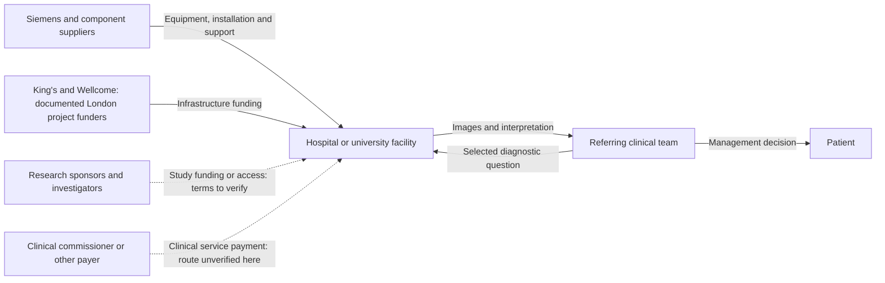

# MAGNETOM Terra 7T MRI: From high-field images to a viable specialist imaging service

**AI-generated reference draft for selection and discussion. Not an assessed submission.** No interviews or original clinical data are claimed. Evidence cutoff: 2026-10-20.

[Research notes and preserved layers](../07-terra.md) · [All drafts](../../reports/README.md) · [Comparative review](../../reports/comparative-review.md)

**Scope:** Original Siemens MAGNETOM Terra diagnostic platform and its 2017 US endpoint; neurovascular value question with head/knee scope retained; later Terra.X and 2021-priority optimisation IP explicitly separated.

**Word count:** 2,574, including references, tables, diagram and notices (whitespace count; verify in submission software).

## Executive summary

MAGNETOM Terra makes a useful engineering case because the scanner, regulatory submission, component suppliers and a London installation are identifiable. The harder question is whether a specialist 7 tesla (7T) service provides enough additional clinical value over existing MRI to justify its resources. This report examines the original Terra, cleared in the US in 2017, as a diagnostic platform for head and extremity imaging. It uses a defined neurovascular problem to examine value and retains knee imaging within the product scope. Later Terra.X capabilities are treated separately. [1] [2]

Public evidence supports a substantial regulatory and manufacturing account. It is less complete on the first scanner's patent families, development budget, eligible local population and payment. A London facility enquiry could improve workflow and cost evidence, but cannot be assumed to resolve confidential corporate history. Terra is therefore attractive for a London-based team willing to investigate a service business case; it is less straightforward if the team wants a fully disclosed startup-financing story.

## Product and original market boundary

MRI uses a static magnetic field, changing magnetic gradients and radiofrequency signals to produce images. Terra's 7T field offers scope for finer anatomical detail, while imposing demanding safety, coil and image-uniformity requirements. The commercial product is the magnet, gradients, RF equipment, software, dedicated coils and installation/support system together. A stronger magnet alone is not a clinical service. [1]

The original US record concerns patients above 30 kg and head or extremity imaging with appropriate coils; the submitted configuration included head and knee coils. It does not establish every musculoskeletal application, whole-body clinical imaging or compatibility with an implant simply because it was safe at 3T. Research options also require their own scope. The manufacturer's brochure describes separate clinical and research modes. The 2024 Terra.X announcement concerns a later generation and upgrade route; its features cannot be retrospectively assigned to the 2017 system. [1] [3] [2]

## 1. Unmet medical need

The relevant need is a diagnostic decision that remains uncertain after existing care, rather than the entire population with a brain or joint disorder. An important example is distinguishing a small intracranial aneurysm from a normal vascular variant after equivocal lower-field imaging. A false positive can create anxiety and further surveillance or invasive investigation; missing a consequential lesion creates a different risk. The report should ask whether Terra improves that decision, for whom, and at what additional cost.

A retrospective single-centre study used the actual Terra in clinical mode and a 3T Prisma in 53 selected patients. The authors reported higher agreement among readers at 7T. However, there was no independent invasive reference standard, and the expert board considered both scans. Readers could not be blinded to field strength. This supports a carefully scoped diagnostic-clarification case, not a general sensitivity claim, demonstrated stroke prevention or realised cost savings. [4]

Focal epilepsy offers a second, distinct investigation route. A published protocol compares Terra with 3T imaging in a selected presurgical pathway where previous imaging did not reveal a lesion. It helps define the comparator, referral criteria and planned assessment, but a protocol is not a completed effectiveness result. Mixing its expected benefits with observed findings would exaggerate the evidence. [5]

For musculoskeletal imaging, the original knee coil establishes a concrete product boundary. It does not establish how many patients gain a changed diagnosis or treatment compared with a good 3T examination. Those clinical and economic questions remain open in this investigation; neurovascular evidence cannot answer them. A final team report should select one pathway for population and cost calculations while describing the wider platform accurately.

The missing denominator is the annual number of suitable local referrals after standard MRI, excluding people who cannot undergo the proposed 7T examination. No defensible London count was recovered. Disease prevalence multiplied by a scanner price would not resolve this. The next study should count unresolved referrals, additional scans, altered decisions and subsequent care, then compare the full pathway with current practice. Our proposed outcomes and costing method are an analytical plan, not measured benefits.

## 2. Intellectual property

The development record identifies a distributed engineering programme. Siemens' brochure attributes the 7T magnet to Siemens Magnet Technology in Oxford, while the FDA file names the system manufacturing site in Erlangen and separate US coil suppliers. This establishes useful places and organisations to investigate; it does not identify the first inventor of every subsystem. A commercial scanner incorporates multiple technologies, so one convenient patent cannot stand for its complete rights position. [3] [1]

One actual Siemens application provides a limited, useful technical example: GB2606208A, *Computer-implemented magnetic resonance image optimisation method*. It names Raphael Tomi-Tricot and Radhouene Neji, lists Siemens Healthcare GmbH as original assignee, and describes experiments using Terra. Its priority date is 29 April 2021. It therefore cannot explain the original scanner's 2017 invention or market entry. Terra's use as experimental equipment also does not establish that the marketed scanner implements the claimed method. [6]

The application's two independent claims can be explained as follows. These are paraphrases of the published application, not a legal opinion or a reading of later granted claims.

| Claim | What the published independent claim requires | Relevance and limit |
|---|---|---|
| 1 | A computer method represents image voxels by location and characteristics, clusters similar voxels, selects cluster centres or representative voxels, and uses these in optimisation to generate a diagnostic image. | A route for discussing computational optimisation of spatially varying MR properties; it does not claim the whole 7T scanner. |
| 12 | A processing system configured to perform the corresponding mapping, clustering, representative-voxel selection and optimisation steps. | A system form of the method, still requiring those technical elements; ownership of Terra hardware alone does not show implementation. |

Claim 13 refers back to earlier method claims and is not counted here as independent. The selected application was read through its claims, but inventor employment at priority, assignments, current legal status, licences and commercial implementation were not fully audited. Most importantly, the original magnet, coils and system patent families remain unidentified at a product-specific level. This section is consequently an honest IP investigation with a later development illustration, not a complete account of the first device's IP. [6]

The highest-value next step is to ask Siemens for the original subsystem/family references, then check the priority documents, inventors' contemporaneous employers and assignments in official registers. A broad portfolio count would add little. Manufacturing records help route that enquiry to the right organisation but cannot substitute for the missing patent-to-product map.

## 3. Fundraising

Terra should be investigated as a corporate product programme. The public development account supports an in-house engineering history; it does not disclose a device budget or prove that every contribution came from internal funds. There is no verified Terra-specific angel round, VC valuation or original development grant in this review. The useful question is which organisation bore each stage of development and validation cost, rather than forcing the scanner into a startup template. [3]

Two public financing records answer different questions:

| Record | What it establishes | What it cannot establish |
|---|---|---|
| King's 2018 installation announcement | King's College London and Wellcome funded the London project; no amount is given in the reviewed announcement. | Siemens' pre-clearance R&D budget, the scanner-only purchase price, or the share allocated to building work. |
| Siemens Healthineers' 2018 IPO announcement | The placement raised approximately EUR4.2bn in gross proceeds for parent Siemens. | New Terra development capital paid into the operating company, or a Terra valuation. |

The first is customer infrastructure/access funding; the second is a later corporate ownership transaction. Both are informative precisely because they prevent money from being attributed to the wrong stage or recipient. Neither fills the original development-finance gap. [7] [8]

A defensible estimate of required early capital would separate magnet engineering and prototypes, RF/coils and gradients, software, safety/performance testing, regulatory work, production tooling and initial service support. Shared platform work would need an explicit allocation rule. Staff numbers, time, loaded salaries, supplier quotations and attributable study costs would produce a bottom-up estimate, checked against comparable programme totals if available. No numerical estimate is presented because these inputs were not recovered; an unsupported total would obscure rather than solve the specification's funding question.

For interviews, the London facility could clarify acquisition and operating resources. Original R&D spending and internal investment decisions need a Siemens historical or finance source. These are different enquiries, even when both concern the same installed scanner.

## 4. Regulatory

FDA record K170840 documents the original 510(k) clearance on 12 October 2017. Terra was classified as Class II under 21 CFR 892.1000, with LNH as the primary product code and additional LNI/MOS codes. This is a substantial-equivalence route for the defined diagnostic system, not a PMA approval or a blanket authorisation of all future research sequences. The submission provides a direct starting point for intended use, configuration, testing and manufacture. [1]

Its evidence needs careful interpretation. The 35-person study described in the submission helped establish peripheral nerve stimulation limits; it was not a 35-patient diagnostic-benefit trial. Reader assessments of sample image pairs address image acceptability and artefacts within that review. They do not demonstrate better patient outcomes, superiority across every indication or an economic return.

The submitted standards include IEC 60601-2-33 for MR equipment safety, IEC 62464-1 for image-quality parameters, IEC 62304 for software lifecycle processes and ISO 14971 for risk management, alongside electrical and electromagnetic compatibility work. Their listed editions are historical submission details. A present compliance account must check the current configuration and applicable requirements; the effective 2026 FDA quality-system rule is separate context, not evidence that this manufacturer has been audited here. [1] [9]

Manufacturing responsibilities are unusually accessible. The FDA summary identifies Siemens Healthcare GmbH in Erlangen as the system manufacturing site, Nova Medical for the head coil and Quality Electrodynamics for the knee coil. The brochure places magnet development/manufacture in Oxford. These records support a component-based supply-chain discussion, without claiming that the entire scanner was built in one country or that the same supplier arrangements remain current. [1] [3]

For a London installation, the team must obtain the current model, software, coils, market documentation and research/clinical operating boundaries. A university equipment page proves an institutional connection, not a complete UK authorisation audit. The original EU certificate, applicable UK documentation and any local upgrade were not independently verified. Likewise, a research-only option cannot be treated as clinically authorised because it runs on a cleared scanner. [10] [2]

## 5. Reimbursement

There are three separate financial flows: buying/installing the scanner, paying for research access, and paying for a clinical diagnostic service. King's and Wellcome's involvement documents a local infrastructure-funding route. It does not show a national NHS entitlement to a 7T examination, a Terra-specific tariff or a recurring clinical operating subsidy. No verified device-specific payment amount, current site price or special 7T premium was recovered. The current NHS payment scheme could not be retrieved beyond its access challenge, so its rules are not asserted here. [7]

The economic case should compare whole pathways. The additional cost includes annualised equipment and site work, maintenance, staff, safety screening, coils, scan time and downtime. Potential offsets include investigations or follow-up avoided only when evidence shows that these changes actually occur. A specialist scanner used for few eligible patients can have a very different cost per useful decision from one with a well-filled programme. Research utilisation and clinical utilisation should be recorded separately to avoid counting the same capacity twice.

The aneurysm study offers a concrete clinical question but not a cost-effectiveness analysis. A future evaluation should measure the extra resource use and downstream decisions against the standard pathway, including uncertainty about missed lesions and avoidable surveillance. It should not price a presumed improvement in image resolution as though it were already a health outcome. A credible business case also asks whether an existing referral centre could meet demand more efficiently than a new installation. [4]

*Figure 1. Analytical stakeholder map for the Terra service case. The London project funders and equipment relationship are documented; dashed arrows identify funding arrangements that require verification. This is not a complete contract map or the missing lecture-specific diagram format.*

The strongest first-hand route is unusually direct: King's lists a MAGNETOM Terra at LoCUS, St Thomas' Hospital, with LOCUS-7T-enquiries@kcl.ac.uk as its enquiry address. Ask the facility team about configuration, eligible referrals, scan resources, cost allocation, research access and clinical commissioning. This is an exact-equipment connection, unlike a generic MRI expert. It does not establish present appointment availability, patient access or routine NHS clinical use. No contact has been made. [10]

## Conclusion

Terra can support a clear report about turning high-field imaging capability into a useful specialist service. Its direct London equipment route and detailed regulatory/manufacturing record are major practical strengths. Original product IP and development capital remain incomplete, while clinical value and sustainable payment require a narrower pathway and local operational evidence. The best next investigation is a specific LoCUS workflow/cost discussion alongside a separate Siemens origin/IP enquiry. For this team, those questions would improve the report more than collecting additional general MRI papers.

**Preparation note:** The specification/examples guided structure and source use; [method and limitations](../../docs/full-report-writing-method.md). No invented author responsibilities, interview accounts or policy-compliance declaration are included.

## References

Source identities and URLs are printed for retrieval without relying on embedded hyperlinks. Dates/coverage reflect the source records; deeper drafting checks are recorded separately in [the evidence log](../../data/full-report-evidence.json).

1. FDA. MAGNETOM Terra: K170840 clearance and 510(k) summary. 2017-10-12. https://www.accessdata.fda.gov/cdrh_docs/pdf17/K170840.pdf (review record: 2026-10-20).

2. Siemens Healthineers. MAGNETOM Terra.X receives FDA clearance. 2024-03-27. https://www.siemens-healthineers.com/en-us/press-room/press-releases/magnetom-terra-x-fda-clearance (review record: 2026-10-20).

3. Siemens Healthineers. MAGNETOM Terra brochure. 2019 file; see original imprint. https://cdn0.scrvt.com/39b415fb07de4d9656c7b516d8e2d907/1800000006633504/e6260b86a79c/2019-MAGNETOM-Terra-brochure_1800000006633504.pdf (review record: 2026-10-20).

4. Radojewski et al. Diagnosis of Small Unruptured Intracranial Aneurysms: Comparison of 7T versus 3T MRI. Online 2023-03-31; Clinical Neuroradiology 34:45–49 (2024). https://link.springer.com/article/10.1007/s00062-023-01282-2 (review record: 2026-10-20).

5. Study protocol: value of 7-T MRI with prospective motion correction and postprocessing for patients with nonlesional epilepsy. 2023-08-14. https://link.springer.com/article/10.1007/s10309-023-00618-9 (review record: 2026-10-20).

6. GB2606208A. Computer-implemented magnetic resonance image optimisation method. Priority 2021-04-29; published 2022-11-02. https://patents.google.com/patent/GB2606208A/en (review record: 2026-10-20).

7. King’s College London. London’s most powerful MRI scanner to transform research. 2018-02-21. https://www.kcl.ac.uk/news/londons-most-powerful-mri-scanner-to-transform-research-copy (review record: 2026-10-20).

8. Siemens Healthineers. Shares start trading: IPO placement and proceeds. 2018-03-16. https://www.siemens-healthineers.com/press/releases/pr-2018030202coen.html (review record: 2026-10-20).

9. FDA. Medical Devices; Quality System Regulation Amendments. 89 FR 7496-7525, document 2024-01709. 2024-02-02; effective 2026-02-02. https://www.govinfo.gov/content/pkg/FR-2024-02-02/html/2024-01709.htm (review record: 2026-10-20).

10. King’s College London. 7T MAGNETOM Terra MRI scanner: LoCUS facility and enquiries. Undated; checked 2026-10-20. https://www.kcl.ac.uk/research/facilities/equipment/7t-magnetom-terra-mri-scanner (review record: 2026-10-20).
